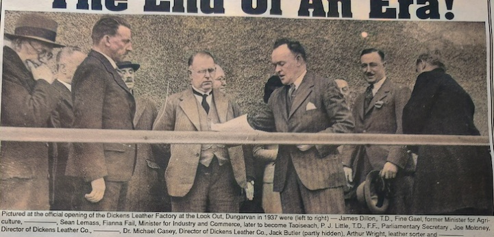

------------------------------------------------------------------------

-   Splendid new leather factory

**Monday, May 3, 1937**

The opening of Dickens Leather Factory, on Monday, 3 September, 1937 was a special day in the town's history and it gives us the ideal opportunity to get introduced to the characters in the story and to understand who was who when the factory opened. Officially opened, that is, because the factory was already up and running for fully twelve months (GET DATES) **and, given the circumstances, that was the hard part done, as we shall see.**

The ceremony began with the arrival of Minister Sean Lemass, who was yet again made Minister of Industry and Commerce in the new Dáil of July 1937, where Fianna Fail rubberstamped their authority on the The Irish Free State, winning exactly 50% of seats, before reconstituting the state by the end of the year. Lemass had been most successful in his first ministerial term, opening up countless new factories around the state, including County Waterford's other leather factory in the village of Portlaw.

Lemass alighted in Abbeyside, the village across the bridge from Dungarvan Town, and he we was met by a local priest and most of the directors of Dickens Leather. Fr **T.B.** Walsh was the Chairman of the Dungarvan Industrial Development Association, a group that included two local, Dr Michael Augustine Casey and **Patrick J.** Molony, the managing director of A. Molony and Sons (**shipping?)**This team had agitated hard to get the factory into Dungarvan and the factory in Portlaw proved to be a complementary stepping stone, in terms of both personnel and output. Portlaw's produce was mostly based on hard cowhide leather, used in the soles of the shoes, whereas Dungarvan's produce was mostly based on softer sheepskin leather, used for upper parts of the shoe and inner linings. Their leadership groups were also hugely overlapping. The Chairman of Dickens Leather was Mr Kennedy O'Brien who was becoming something leather baron across Ireland. He was **CHAIR**? of Portlaw, and his core business was as leather merchant in Dublin City. And the Managing Director was the eponymous Reginald Dickens from England, and his family's core business was in Northampton, the most famous city in the world for leather and shoe production. Dungarvan and Portlaw, for him, were side ventures from his main business, run by Reginald and his brothers, and by their father before them since 1897.

The town was ready for its big day and once the men of influence had assembled, the triumphal procession could begin to slither through the freshly decorated streets, to the roars of the crowd, as cheer after cheer rent the air. Varicoloured bunting festooned the main streets and large banners welcomed the Minister to the town. The local Gardaí formed a bodyguard for Lemass and the parade was fronted by the Waterford Brass and Reed band playing familiar airs, many with a nationalistic bent, for the day was an expression of both national and local pride. The crowd filed in behind them like mass-goers forming a queue for communion and, on arrival at Quay Street, they were met by the hundred-plus men who worked in the factory nearby, at The Lookout, looking out at the wide expanse of Dungarvan Bay.

A temporary stand was erected and Lemass was greeted by Kennedy O'Brien in his capacity of Chairman of Dickens Leather. Meanwhile, the band played the National Anthem while the deep crowds looked on. Several welcoming addresses were made. First up were The Urban District Council and then Father Walsh himself. Not one, but two local Fianna Fail groups gave an address: the Padraig Pearse Cumann and the Cathal Brugha Cumannn and, finally, an unidentified of the factory's workforce said some words, with no name given by any of the newspaper reports.

The last public address was made by Lemass himself. He thanked and congratulated the above-mentioned men of power, the workers and his Fianna Fail colleagues in the Cumainn, but also spoke the crowd themselves, noting the importance of the factory in generating employment and prosperity to the locality.

Afterwards, O'Brien presented Lemass with a symbolic gold key to the factory, and, with the church and local government and the politicians having all had their say, and with the band playing Faith of Fathers, it was time for the factory to be blessed solemnly by His Lordship, The Most Reverand Doctor Jeremiah Kinane, Bishop of Waterford and Lismore, ably assisted by the Parish Priest, The Very Reverand T. Canon O'Brien, and his curate, the above-mentioned Reverand TB Walsh.

Afterwards, Dickens gave the Bishop and Minister a guided tour of inspection of the factory

------------------------------------------------------------------------

The factory was left open for the local hoards to investigate and one wonders how well supervised the machines were with children running round.

Later in the day, Lemass would point out how great it was that the factory was a truly local venture – and it certainly was for the staff employed in the factory. But the reality is that the directors were a mix of locals (Austie Casey and Joe Molony) with bigger fish.

In July 1937, Fianna Fail had yet again won the general election, and were continuing their policy of applying huge tariffs on imported goods, a policy which facilitated the growth of an unprecendented number of mid-sized factories around the state. Sean Lemass was again the Minister of Industry and Commerce, a position he would hold between 1932 and 1959 for for sixteen intermittent years.

------------------------------------------------------------------------

The opening of Dickens Leather Factory, on Monday, 3 September, 1937 was a special day in the town's history and it gives us the ideal opportunity to get introduced to the characters in the story and to understand who was who when the factory opened.

-   Officially opened, that is, because the factory was already up and running for fully twelve months (GET DATES)

<!-- -->

-   **and, given the circumstances, that was the hard part done, as we shall see.**

-   The ceremony began with the arrival of Minister Sean Lemass,

    -   who was yet again made Minister of Industry and Commerce

    -   in the new Dáil of July 1937, where Fianna Fail rubberstamped their authority on the The Irish Free State, winning exactly 50% of seats, before reconstituting the state by the end of the year.

    -   Lemass had been most successful in his first ministerial term, opening up countless new factories around the state, including County Waterford's other leather factory in the village of Portlaw.

-   Lemass alighted in Abbeyside,

    -   the village across the bridge from Dungarvan Town,

    -   and he we was met by a local priest and most of the directors of Dickens Leather.

        -   Fr **T.B.** Walsh was the Chairman of the Dungarvan Industrial Development Association, a group that included two local, Dr Michael Augustine Casey and **Patrick J.** Molony, the managing director of A. Molony and Sons (**shipping?)**

        -   This team had agitated hard to get the factory into Dungarvan

        -   and the factory in Portlaw proved to be a complementary stepping stone, in terms of both personnel and output.

        -   Portlaw's produce was mostly based on hard cowhide leather, used in the soles of the shoes, whereas Dungarvan's produce was mostly based on softer sheepskin leather, used for upper parts of the shoe and inner linings. Their leadership groups were also hugely overlapping. T

        -   he Chairman of Dickens Leather was Mr Kennedy O'Brien who was becoming something leather baron across Ireland. He was **CHAIR**? of Portlaw, and his core business was as leather merchant in Dublin City.

        -   And the Managing Director was the eponymous Reginald Dickens from England, and his family's core business was in Northampton, the most famous city in the world for leather and shoe production. Dungarvan and Portlaw, for him, were side ventures from his main business, run by Reginald and his brothers, and by their father before them since 1897.

-   The town was ready for its big day and once the men of influence had assembled,

    -   the triumphal procession could begin to slither through the freshly decorated streets,

    -   to the roars of the crowd, as cheer after cheer rent the air.

    -   Varicoloured bunting festooned the main streets and large banners welcomed the Minister to the town.

    -   The local Gardaí formed a bodyguard for Lemass and the parade was fronted by the Waterford Brass and Reed band playing familiar airs, many with a nationalistic bent, for the day was an expression of both national and local pride.

    -   The crowd filed in behind them like mass-goers forming a queue for communion and,

    -   on arrival at Quay Street, they were met by the hundred-plus men who worked in the factory nearby, at The Lookout, looking out at the wide expanse of Dungarvan Bay.

-   

-   A temporary stand was erected and Lemass was greeted by Kennedy O'Brien in his capacity of Chairman of Dickens Leather.

    -   Meanwhile, the band played the National Anthem while the deep crowds looked on.

    -   Several welcoming addresses were made.

    -   First up were The Urban District Council and then Father Walsh himself.

    -   Not one, but two local Fianna Fail groups gave an address: the Padraig Pearse Cumann and the Cathal Brugha Cumannn and,

    -   finally, an unidentified of the factory's workforce said some words, with no name given by any of the newspaper reports.

-   The last public address was made by Lemass himself.

    -   He thanked and congratulated the above-mentioned men of power, the workers and his Fianna Fail colleagues in the Cumainn,

    -   but also spoke the crowd themselves, noting the importance of the factory in generating employment and prosperity to the locality.

-   Afterwards, O'Brien presented Lemass with a symbolic gold key to the factory, and,

    -   with the church and local government and the politicians having all had their say,

    -   and with the band playing Faith of Fathers,

    -   it was time for the factory to be blessed solemnly by His Lordship, The Most Reverand Doctor Jeremiah Kinane, Bishop of Waterford and Lismore, ably assisted by the Parish Priest, The Very Reverand T. Canon O'Brien, and his curate, the above-mentioned Reverand TB Walsh.

-   Afterwards, Dickens gave the Bishop and Minister a guided tour of inspection of the factory

------------------------------------------------------------------------

The factory was left open for the local hoards to investigate and one wonders how well supervised the machines were with children running round.

Later in the day, Lemass would point out how great it was that the factory was a truly local venture – and it certainly was for the staff employed in the factory. But the reality is that the directors were a mix of locals (Austie Casey and Joe Molony) with bigger fish.

In July 1937, Fianna Fail had yet again won the general election, and were continuing their policy of applying huge tariffs on imported goods, a policy which facilitated the growth of an unprecendented number of mid-sized factories around the state. Sean Lemass was again the Minister of Industry and Commerce, a position he would hold between 1932 and 1959 for for sixteen intermittent years.

Portlaw opening

-   Bishop

-   Lemass

-   few months after opening

    -   Irish Tanners, Ltd

-   Milling rain

-   residents of the village

    -   profusely decorated

    -   gaily decked with flags and bunting stgreamers

-   Portlaw Pipers, Brass and Read band

-   Vincent Crowley, Chairman, golden key for Lemass

-   RJ Hearne, director

-   leading Waterford & Portlaw businessmen

-   Guard of honour by gardai

-   GEtting a crowd then was easier

-   platform erected

-   MJ Hennebrym, FF Cumann

-   Tour of inspection

    -   ultra-modern machinery

-   TDs\> Mrs Redmond, Sean Goulding, N Wall

-   film projectrd showing the factory before and after

-   FF has rediscovered the truth that every man is born with a right to human living conditions, a right to the staple possession of the necessities of life and the means to his ultimate end.

-   Decision to choose Portlaw rested with Lemass

    -   help to restore the prosperity of the town

Vincent Crowley

------------------------------------------------------------------------

AI Version of the above

woke that morning already tired.

Not the honest tiredness of a long day’s work, but the kind that comes from months of holding a thing together with talk, favours, and the thinnest thread of confidence. The factory had been running close to a year at that point, officially or not, and anyone who thinks the opening ceremony was the hard part never tried to keep men paid, machinery fed, and raw hides arriving on time in a town that had never seen an enterprise like this before.

But this day was not for the ledger. This day was for the story we were telling ourselves.

The town had dressed itself up as if for a patron’s day. Bunting in the streets. Flags. Streamers. Fresh paint where there had been flaking walls. People who had grumbled for months suddenly proud to be seen applauding. I watched it all through the window at Mountain View and felt the familiar double-pull: gratitude and suspicion.

Gratitude, because the thing existed at all.

Suspicion, because Ireland loves a parade almost as much as it loves a post-mortem.

We were to meet the Minister in Abbeyside, across the bridge. That was decided by people who liked their ceremonies neat: the Minister arrives, the dignitaries assemble, and then the procession can be controlled from the first step. I drove over early, not trusting the day to behave on its own. When you have lived through committees and subscriptions and late-night arguments in back rooms, you learn that the public moment is the reward, yes, but it is also the risk. One wrong word. One wrong face. One heckler with a grievance. And the headline becomes something else entirely.

Seán Lemass arrived with the air of a man who had already opened ten factories this month and had a train to catch for the eleventh. He stepped out, brisk and composed, and the Gardaí formed themselves around him as if to protect the State from the town’s affection.

Father T. B. Walsh was there, of course, straight-backed and watchful, the Chairman of the Industrial Development Association and the kind of priest who could talk about salvation and employment in the same breath without seeming to change subjects. Joe Molony stood near him, looking like a man who’d rather be checking a delivery than standing for a photograph. There were introductions and handshakes and those polite half-sentences that pass for warmth when the real business is power.

Kennedy O’Brien arrived last, as if time adjusted itself to him. O’Brien always looked as if he had just stepped out of a better room than the one he was presently in. A Dublin leather merchant, a man of Portlaw as well as Dungarvan, and chairman of our board in a way that made the whole enterprise feel more serious to the Department and more alien to the town, depending on who was speaking.

And then there was Reginald Dickens.

Dickens stood slightly apart, not by accident, but by habit. Northampton had made him: the capital of boot and shoe, of tanneries that had been turning hides into money for generations. He was a technical man, and a family man, and a man who had come to Ireland not out of romance but out of opportunity. Dungarvan and Portlaw were ventures, yes, but I had learned that Dickens was not the type to treat a venture lightly. He wanted the thing to work. His pride was stitched into it.

If you looked closely, you could see the entire arrangement in those four bodies: Walsh with the local legitimacy, Molony with the local commerce, O’Brien with the Irish trade and the boardroom weight, Dickens with the methods and the machinery. And me—me with the awkward task of being both local and larger than local, the doctor who had somehow become a director, the man who could be praised for bringing industry and blamed when it stank.

When Lemass turned to me, his expression was courteous in the way of city men who do not waste feeling on strangers.

“Doctor Casey,” he said.

“Minister,” I replied.

His handshake was quick. Efficient. A handshake that implied there were many more waiting behind me. But his eyes held mine an extra second, and I understood what he was measuring. Not my loyalty. Not my charm. My usefulness. My capacity to carry a thing.

Lemass had been the engine behind this entire era—tariffs, protection, factories sprouting like sudden teeth in towns that had been gum for years. Portlaw had come before us, hard cowhide leathers for soles and sturdier work; we were the softer side of the same ambition, sheepskin and light leathers for uppers and linings, for gloves and fancy goods, bookbinding if we could manage it. A planned variety, a national basket where each town was told what to weave.

That was the Department’s genius and its arrogance: it could look at a map and see a country not as people but as functions.

We began to move.

The procession slithered, as someone later wrote, through the decorated streets. That was accurate. A parade is never a march so much as a creature: it bends around corners, swells, pauses, surges again. The Waterford Brass and Reed Band led the way, playing airs the crowd already knew by heart, tunes that had one foot in the church and one in the struggle. People cheered like it was a match day. Like the Minister’s presence itself could be converted into wages by applause.

I walked behind Lemass and beside Walsh, with O’Brien close enough to be seen and Dickens close enough to disappear if he wished. The Gardaí kept their neat line, a guard of honour and a reminder both. The crowd fell in behind us, thick as a tide, and I couldn’t help thinking of communion lines, yes, but also of funerals: that same solemn appetite to witness history and then talk about it for years.

At Quay Street the factory men were waiting—hundreds of them, or it looked that way with the day swelling everything into legend. The young lads trained up in the Technical School. The older hands who had taken to the machines with suspicion and then, slowly, with a kind of grim pride. Their faces were clean for the occasion, but their hands were the truth of the thing. No speech ever paid a man; a payroll did.

A platform had been erected—temporary wood pretending at permanence. From it we looked down over the crowd, and for a moment I felt a jolt of fear. Not stage fright. Something more intimate: the fear of being found out. Because every person there had their own version of this factory in their head. To some it was salvation. To others, a stink. To others, a political trick. And all of them wanted today to confirm their version.

Kennedy O’Brien greeted Lemass formally, chairman to minister, and the band played the anthem. The sound climbed up over the bay and for a moment the whole thing felt like a state occasion, which, in a way, it was. A small town being brought into the national story with trumpets.

Addresses followed.

The Urban District Council first, of course, because local government never misses a chance to be seen near importance. Then Father Walsh, who could talk about employment as if it were a work of mercy. Then the Fianna Fáil cumainn—the Pádraig Pearse and the Cathal Brugha—each keen to remind the Minister and the crowd that politics had brought this day about, and politics would take credit for it.

Somebody from the workforce spoke too—unidentified in the reports, as if the worker were a representative creature rather than a person. I remember thinking: the factory exists because those men have learned to run the machines, but the papers cannot even be bothered to write down one name.

Then Lemass stood.

He had the knack of speaking like a man doing you a favour without ever using the language of favour. He thanked the
