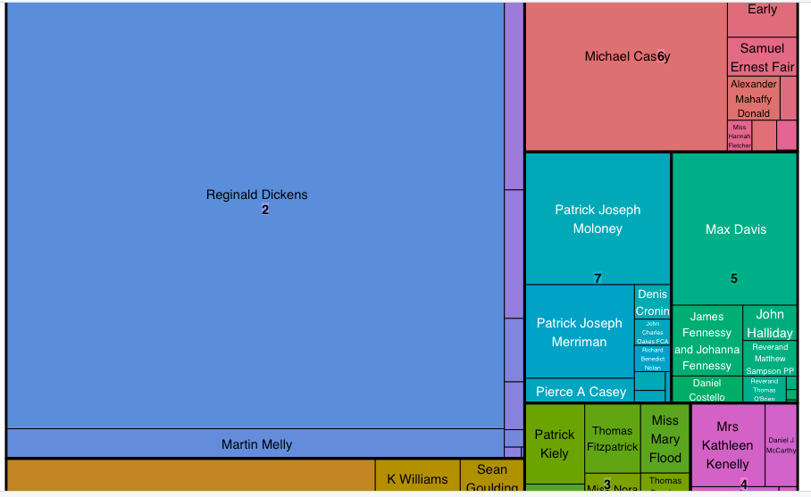

*"very few people realise the strenuous work that Austie Casey put into the starting of the two factories".*

It seems unfathomable now to imagine a doctor in an Irish town becoming an investor in and director of a factory and still keeping on both roles. Understanding the circumstances will take quite some explication of the many inputs that went into the establishment of a factory – out the blue essentially – between the people and the politics, the money and the materials. \
Most importantly, we need to understand that factories were being set up all over the country in the early 1930s, after Fianna Fail came to power with the agenda of making The Irish Free State self-sufficient. Dungarvan's tannery was just one instance of many in the country but its success was not a given. A very large number of factors had to come together and many towns could not provide them all.

Working backwards will make it easier to understand the issues as they become increasingly less obvious as we go up the chain and back in time. At the end of the chain were the people of Dungarvan to do the work, and an important argument in favour of having a factory in Dungarvan was the poverty and unemployment endemic in the then struggling town, issues that were best understood by Medical Officer, Dr Michael Augustine Casey. The work took skill and so much training had be provided to the workers. Running in parallel to this need was the Fianna Fail government's desire to get re-elected from the votes of the workers, their families and the wider community.

A factory needs buildings and a site had to be located. It was not strictly necessary to have a purpose-built operation, although not having one would cause difficulties down the line. A factory needs input materials which need to be sourced and a tannery needs, more than anything, animal hides and dyeing agents. In the early 1930s, hides were in remarkably low supply in Ireland because her livestock was mostly exported to Britain, 'on the hoof', although this flow was rapidly diminishing with the economic war that had broken out between the two states.

Next, the factory needed to be financed, and money had to be raised from shareholders. It had to be managed, a job for directors. This is where we hit our first political curiosity of the time. There did not exist enough industrial knowhow in Ireland to find enough knowledgeable directors to run the factories. Yet there was a need to have local people on the board, partly to look good but also to provide a workable liaison between the factory staff and the two outsider groups. There were the foreign investors such as Dickens but also professional middlemen based in the capital. Politicians of course but also lawyers and accountants, city slickers who lacked the local knowledge of the 'ruddy faced gombeen men' of the towns. Like many industries, tanning had all but vanished from Ireland by the early 1920s so there was a severe lack of bona fide leather men to run the business. Many of them had to be found abroad in England which was the worldwide centre of the leather industry, and choosing them was another job in its own right.

**Of course somebody had to mediate between these imported industrialists and the 'ruddy faced gombeen men' of rural Ireland. This is where the Dublin-based professional class come into the picture. Accountants. Lawyers. Experienced board members who know how businesses run, even if they know nothing about leather. And finally, the men at the top, the Fianna Fail government whose idea it was to stimulate production by massively increasing the tariffs on imported leather.**

Finally, nothing above suggests that Dungarvan in particular ought to have been chosen for a tannery and thus we must understand the need for a local agitation group, the Dungarvan Industrial Development Committee, chaired by Fr Tommy Walsh and giving a platform for the likes of Austie Casey to agitate for jobs to be brought to the town.

### **The long decline of the leather industry in Ireland**

The emergence of a leather industry in 1930s Ireland was akin to a resurrection from a long and painful death. The previous hundred years had seen a steady decline of a once-flourishing native industry. Local economies were remarkably self-sufficient. Small tanneries, often situated on the outskirts of towns and villages, processed hides supplied by local farmers, providing leather for shoemakers, saddlers and other craftsmen. The peak of producation was in the 1820s and 1830s and the decline started once livestock began to be exported en masse to Britain, thanks to improvements in sea communications. These was the era when lighthouses began to pop up along the Irish coast and making travel a lot safer. From then on, there fewer and fewer hides were available for tanning. In 1837 there were 46 tanneries in the city of Cork alone, tanning over 2000 hides per week. and employing 625 people, which is more people than were employed across the twenty-six counties at the height of the resurrection in the

By 1852, after The Great Hunger had decimated the island, there were still 26 tanneries in Cork City, although few of them were operating full-time as demand for leather had understandably dropped. Credit was also scarce so the businesses couldn't get back on their feet. By 1902, there were just three tanneries in Cork and just 18 across the entire island of Ireland. In 1923, when a Free State report was commissioned, there were just five. The only large-scale operation was Callaghans in Limerick City, tanning 200 hides per week, and small operations in Thomastown, Clonmel, Ballitore and New Ross, tanning just 100 hiders per week between them. Ballitore, a tiny village in County Kildare, specialised in leather harnesses for horses. In total, these tanneries were supplying just one twentieth of the state's demand for leather, so the other 95% had to be imported. Even so, the tannery in New Ross would close down in 1924.

The reasons for the decline of the leather industry thus provide us with something of a microcosm of the problems that Ireland faced during the tragic century between the 1820s and 1920s. A tannery needs two things more than anything else: animal skins and dyes for tanning, and both of these were being purged from the country. Livestock were shipped to Britain in ever-increasing numbers and with them vanished the jobs associated with processing the animals, such as butchering the flesh and tanning the skins. Meanwhile, dyes taken from oak bark were becoming harder to source due to Ireland's relentless deforestation, although by our time of interest, different dyes were being used, and it is notable that the use of new chrome dyes would be advertised in newspaper announcements about Dickens Leather.

A completely different, and preventable problem, was in how duties were levied on tanners. In England, tanners paid duty on every hide processed whereas in Ireland they paid duty on the pits used for processing them, so too many hides would be processed in the one pit, resulting in lower quality leather being made throughout Ireland, and thus greater demand for leather imported from across the water. Finally, there was little hope of any Irish tanneries exporting leather to Britain, seeing as Britain imposed a 60% tariff on Irish leather but there was only a 10% tariff in the opposite direction. Thus Britain benefited from access to Irish food, hides and other raw materials, while British manufacturers benefited from access to Irish consumers. Any development of independent Irish manufacturing could threaten that arrangement.

**Brits In – the paradoxical revival of native manufacturing**

From the inception of the Free State, there was a strong desire to revive Ireland's dormant manufacturing sector, and the obvious way to stimulate growth was to introduce tariffs on imported goods, a practice that was becoming increasingly common around the world. Simple as this may sound, the government in the 1920s were slow to introduce tariffs as there was a general concern that local business would be undercut by tariff jumpers, companies who set up production facilities abroad in order to dodge import tariffs. It was feared that the tariff jumpers would charge lower prices and even pay more for local labour, a double whammy that would be hard to compete with in a market as small as Ireland's. Perhaps the best-known example of tariff jumping in Ireland was the decision of Henry Ford to manufacture his cars in Cork City, even though its founding in 1917 pre-dated Ireland's independence. The concept of native Irish production was highly problematic because new industries could not be magicked up by the new Free State. Somebody had to provide capital for factories to be built and somebody, often the same people, had to train the workers how to manufacture goods. A subtler problem was that Ireland's tiny market did not provide economies of scale, although it would take decades for this problem to fully manifest.

Between 1922 and 1932, there was no improvement in the Irish leather industry, but a little improvement in footwear production, helping to pave the way for native leather production which could then be used as a raw material for footwear. In 1924, small tariffs of 15% were introduced on footwear sales in Ireland, but British manufacturers were mostly efficient enough to outprice the emerging batch of Irish producers. However, some UK-based businesses began to arrive in The Free State with Edward Donaghy bringing his entire business over the border from Lisburn to Dundalk and, in 1928, John Halliday of Leeds also set up a factory in Dundalk. County Louth would become something of a hub for the Irish footwear industry. Meanwhile, the Irish Tanners Foundation decided that they also wanted some support, so they lodged a case with the newly-formed Tariff Commission, but they got insufficient help until Fianna Fail were elected in 1932.

## **Tariffs and factories**

At the end of 1932, Fianna Fail introduced very large tariffs on all imported footwear. A full 30% duty was put on leather footwear and 20% on non-leather and children's footwear, a preferential rate that would soon be abolished, leaving a 30% tariff on all footwear. This immediately stimulated demand for footwear production in Ireland because the set up costs were relatively low for producing such light goods. Over the 1930s, no industry grew more, in terms of percentage employment growth, than the footwear and leather industries. In 1931, there were 1195 workers in the industry but by 1938 there were 6547 workers, an increase of 448%. By 1933, five new factories were producing shoes but of course the tanned leather still had to be imported, since there were scarcely any tanneries in the entire country. This was doubly inefficient, as much of leather would have come from cattle and sheep which had been reared in Ireland before being sent to Britain for slaughter, butchering and tanning.

This would quickly change and by 1938, several tanneries had been established, mostly around the south-east of the country, in Portlaw, New Ross, Gorey, Dungarvan, and Carrick-on-Suir. Together they employed 1178 people, of the above-mentioned 6547, by far the largest number of people employed in the industry since the famine. At this point, homegrown production was exceeding imports for the first time. The choice of locations is particularly interesting because it tells us a lot about the priorities of the day, and they were seldom economic. In 1936, the Gorey Leather Company was set up by JH Woodington of Bristol who already had a footwear factory in Drogheda and wanted to locate nearby. While such a cluster would make good business sense, and might even lead to County Louth becoming an industrial hotspot like so many towns in Britain, it did nothing for Fianna Fail's expedient need to spread jobs, and thus votes, around the country. The tannery ended up being located in Gorey, Co Wexford, a town which is five miles from the sea, and a pipe had to be build in order to dispose of its noxious waste.

Another tannery investor wanted to set up shop in Bray but he was politely informed that "the farther he decided to go from the city the greater the attraction would he lend to the proposal". (Daly 108). Mr Geoffrey Barlow, who ended up investing in the Portlaw tannery, originally wanted to base his operation in Drogheda, near several footwear factories. Instead it was suggested that he head for one of Tralee, Sligo, New Ross or Portlaw. Of course the English had little interest in far-off towns like Sligo and Tralee as it did nothing for access of distribution. It can easily be forgotten that the West of Ireland, which forms something of an equidistant semi-circle around Dublin, provides zero access to England, or indeed anywhere else, whereas the Ancient East, namely the coast running from Cork City to Rosslare and up to Dundalk, provides excellent access to England and Wales. In the end, both Portlaw and New Ross would get tanneries. Portlaw had the distinct advantage of resurrecting a disused Cotton factory which had been idle since the 1870s while New Ross had only recently closed its doors to one of the very last tanneries in the Free State. The common denominator in Portlaw, New Ross and Dungarvan, was Kennedy O'Brien, who would be the first Chairman of the board in Dickens Leather, a position later filled in turn by both Austie, Pierce, and Anne Casey. Understanding O'Brien's story is crucial because his life was a foil to Austie Casey. Both lives contained the same overlapping elements only in different proportions, and we can see how much could be achieved by an industrialist who did not have to concern himself with the already hectic day-to-day life of a doctor.

## Kennedy O'Brien

![*The Tannery in Portlaw was huge but its output complemented its Dungarvan counterpart.*[^shareholders_info-1]](images/portlaw_ad_largest_tannery_in_ireland.png){alt="The Tannery in Portlaw was huge but its output complemented its Dungarvan counterpart."}

[^shareholders_info-1]: Image taken from Waterford News, 27 September, 1935

[^shareholders_info-2]: Image taken from Waterford News, 27 September, 1935

Kennedy O’Brien was one of the few *bona fide* leather men left in early Free State Ireland. Yet over the next few decades he helped to build up the industry more than any other person on the ground.

Kennedy O'Brien grew up in Limerick, the son of pig buyer also called Kennedy O’Brien. *Kennedy* was a given name that went back for generations in that branch of the family and census records of 1911 show eleven men in Ireland of that name, possibly all them related as most of them were in the Limerick area, and only one lived improbably far away. There might have been even more *Kennedy O'Briens*, only the Catholic Church didn’t like children to be baptised with anything other than a saint’s name. O'Brien family lore claims that there was a cheeky way of twisting the church's arm. Our Kennedy's father simply told the Parish Priest that if he didn't let his son be baptised with the preferred name, then the child would be brought round the corner and baptised a Protestant. This would do the trick and thus the curious, heavy-duty, forename lived on.

Our Kennedy O'Brien was aged 22 at the 1911 census, making him a full decade older than Austie Casey. He was listed as an accountant but seems to have already begun working in O'Callaghan's Tannery in Limerick City, the last surviving large-scale tannery on the island. He was head-hunted by the Managing Director, Michael O'Callaghan, who would later serve as Mayor of Limerick before being murdered in 1921, likely by the Black and Tans or the RIC Auxiliaries.[^shareholders_info-3] O'Callaghan said he needed someone to help him estimate the number of hides needed in the factory – clearly a job suited to a man of numbers – but O'Brien already had a job lined up in Dublin and was due to begin a few months later. O'Callaghan said that the clever young man was free to leave when his other job was ready to start. O'Brien took the job and clearly found his place in the world as he spent the rest of his life selling and making leather, as well as spawning a handful of sons who followed him into the trade, including yet another Kennedy O'Brien.

[^shareholders_info-3]: <https://www.dib.ie/biography/ocallaghan-michael-a6546>

Having established himself within the Limerick tannery buildings, and built the trust of his boss, O'Brien was given a car and sent out to sell O'Callaghan's leather to the shoemakers and shoe repair shops of Ireland – all thirty-two counties, as partition was yet to be implemented. This constant movement suited his restless nature and it also gave him a great appreciation of the needs of the Irish people. While Austie Casey knew the plight of individuals in Dungarvan, Kennedy O'Brien developed a bigger-picture view of the entire island. He could see the need for more employment but also the country's need for a native tanning industry, rather than importing almost all of its leather from Britain, much of it made from the hides of exported Irish livestock.

In 1927, O'Brien set up his own business as a wholesale leather merchant, on 27 North Frederick St in Dublin City, and that building would become the centre of operations for his ever-expanding leather empire. It is likely that O'Brien became friendly with Sean Lemass around this time. Lemass was a keen golfer by day and a poker player by night, an activity he seemingly picked up during his time in prison in The Curragh where, unlike other inmates, he never received a penny in the post, making poker his only source of income. Once Lemass became a government minister he was known to create opportunities for businessmen on the rise, especially in industries which required minimal amounts of capital such as clothing and footwear.[^shareholders_info-4]

[^shareholders_info-4]: It is not clear exactly when Kennedy O'Brien became friendly with Sean Lemass, and it is not clear if perhaps O'Brien was involved at all in the Republican movement. His father seems to have been sympathetic and his brother is known to have been actively involved as a gun runner during the revolutionary years. Their father, Kennedy Sr, bought and sold pigs in Limerick, and it became Bart's job to walk around with a cart and amass pig swill from the local hotels. This noxious task proved to be the ideal cover for transporting guns because they could be wrapped and placed beneath the swill. And if he was stopped by the police of the auxiliaries, none of them would swirl their hand through the filthy pit of used food. And while this method of transportation befuddled the authorities for a time, word must have leaked out because Bart was tipped off that they were on his case, so he fled to New York where he got a job with the Pinkerton Detective agency and, thanks to his free transport pass, he resumed his gun-running acitivities, only at the other end of the chain.

Yet cronyism aside, there is unlikely to have been anyone better suited than O'Brien to the task of planning a native tanning industry, between his years of experience, his knowledge of the entire country from his time on the road, and his deep zeal for employment creation. Thus having the Dublin Minister's ear would prove most invaluable once the Fianna Fail government took control of the country in 1932 and set out their twin policies of protectionism and decentralization, leading to the establishment of so many factories around the towns of Ireland, big and small. By the mid 1930s, O'Brien's Dublin business was firmly established, so he would have the time and energy to throw into the Portlaw venture, which would remain his primary concern throughout his working life.

**Why Portlaw?**

The choice of a settlement as small as Portlaw might seem odd for such a large operation, but DJ Dwyer, in his 1962 study of the Irish Tanning industry, considers it something of a prototypical choice for a tannery. One requirement was easy access to a port (Waterford) as tanning agents had to be imported from around the globe. Secondly, tanneries are better suited to a rural location as the smell and waste are so obnoxious. And finally, there needs to be a lot of water available, coming in and going out of the factory. Water is brought in for the tanning itself and, however unsatisfactory it might be to modern sensibilities, a body of water was needed to dump the untreated waste. The Portlaw tannery sat on a bend on the River Clodiagh, a tributary of the River Suir, again providing water on both sides. The site had previously been used for a cotton mill in the nineteenth century, run by a Quaker family. Indeed the town was purpose-built for its workers and, when the tannery finally opened, a former employee of the mill, aged 94, showed up and demanded to be given a job in his old haunt.

It turns out that Lemass was, in the end, somewhat regretful at having chosen Portlaw as the site of the first Irish tannery. The town, nay village, was so small that the meal for the opening ceremony in 1935 had to be cooked in Waterford and transported to Portlaw. Fianna Fail might have gained more political traction by putting it into a town with a much larger population – such as the above-mentioned Tralee or Sligo – where the staff's wages could be recirculated more easily, bringing bonhomie to a wider array of voters. Lemass's choice of Portlaw was also informed by government officials who underestimated the coming demand for leather as the state sought self-sufficiency. It quickly became clear that their estimate of 225,000 hides *per annum* was too low and so was a second estimate of 300,000 hides, made by Vincent Crowley, a Dublin-based solicitor who became Chairman of Irish Tanners and also the accountant for Dickens Leather.

**Personnel**

While the workers in Irish Tanners Portlaw were local, the management group most certainly weren't. Kennedy O'Brien became a director and general manager, running the day-to-day operations while his Dublin business ticked over. Crowley was chairman and the secretary was his employee, Dr Jeremiah Dempsey, another city-based professional with his finger in the provincial pie. Despite the name of the tannery, it was actually British-owned and Mary Daly notes this it was registered to the tariff-jumping "British entrepreneur who already owned Western Tanning of Bristol and Redvales Ltd. of Bury." Presumably, this was HG Barlow, the Managing Director of Irish Tanners, Portlaw's equivalent of Reginald Dickens who himself was also present at the opening ceremony, along with Dr Austie Casey and many other prominent men of County Waterford.

In retrospect, it makes sense to view Portlaw and Dungarvan as complementary businesses, run by an overlapping group of people, especially in the beginning. They were not in direct competition because Portlaw focussed on hard leather soles for shoes, taken from tougher cowhides, whereas Dungarvan would focus on soft leathers taken from sheepskins. We might also think of the Portlaw and Dungarvan tanneries as a three-way compromise between three societal forces. The provincial townspeople did the actual work; capital and industry expertise came from British entrepreneurs (but not the British state); while those based in Dublin functioned as intermediaries between the two.

However, a new law (The Control of Manufacturers Acts 1932-4) introduced by Fianna Fail required that the new industries not have majority control from a foreign company. Irish Tanners was in part funded by the Irish Credit Company, represented at the opening ceremony by its chairman, J.P. Colbert.[^shareholders_info-5] The ICC was formed in 1933 in an effort to fund the new industries popping up around the country, and it is not much of a jump to imagine that the Dungarvan Tannery, with its complementary output, may have been envisioned as being a second branch of Irish Tanners. However, the ICC did not fund Dungarvan – perhaps it ran out of cash – so Irish capital had to be found from somewhere. We shall see in the next chapter that Reginald Dickens owned exactly half of the shares in Dickens Leather, and no capital came from the state. Thus the Irish interest had to be filled by someone, and Austie Casey and Joe Moloney stepped up to the

[^shareholders_info-5]: Colbert, John Patrick \| Dictionary of Irish Biography

| Address | Name | Portlaw | Dickens Leather |
|------------------|------------------|------------------|------------------|
| Dublin | Kennedy O'Brien | Director & General Manager | Chairman & Director |
| England | HG Barlow | Managing Director | \- |
| Northampton | Reginald Dickens | (present at opening) | Managing Director |
| Dublin | Vincent Crowley | Chairman | Accountant |
| Waterford | R J Hearne | Director | \- |
| Dublin | Irish Credit Corporation | capital investors | \- |
| Dungarvan | Austie Casey | \- | Director |
| Dungarvan | Joe Molony | \- | Director |

Managing Portlaw remained O'Brien's primary focus, and by 1957 it was said to be the sixth largest tannery in the world, and managed by his son Bartholemew. His sons became ever more involved in the family business, and Kennedy's urge to create employment and wealth for his family, saw him set up something of a corridor of his own tanneries stretching between Dublin and Waterford. The first of these was in Gorey (1936) and later in Milford, Co Carlow, Rathangan, Co Kildare and Carnew, Co Wicklow**.** Meanwhile, his operations in Dublin continued to grow. He had a team of ladies on one floor cutting upper leathers for the shoe repairmen of Dublin and another team producing metal parts for working boots, parts which previously had to be imported from England.

One final story should illustrate the continued importance of Kennedy O'Brien to the Irish leather industry, and its ultimate demise in the latter part of the twentieth century. Among his many ventures, O'Brien, along with his namesake son, began producing football boots and running shoes, under the brand name *Kayobee*, taken from their initials. Kayobee shoes were worn in 1956 by Ronny Delany when he won an Olympic Gold medal in the 1500m, Ireland's first gold medal since 1932, and the first to be televised. The 1950s would turn out to be the high point of the Irish leather industry, before plastics began to be used, and protectionist policies were relaxed, by Lemass himself. Meanwhile, Kayobee shoes, like all regional brands, would be ousted by some of the most iconic brands in the world, and the Irish tanneries slowly faded into oblivion. Our Kennedy O'Brien died in 1959 and his business was liquidated in 1972. The Portlaw tannery, having let go of its staff over several phases, finally closed in 1985 and the derelict factory was finally sold in 2024.

## **Dungarvan agitating**

-   *Most Irish towns sought a new factory or
    revival of an old industry, and local development committees mushroomed following the 1932 election.*

-   

    -   *those in Nenagh and Kilkenny identified a prospective investor. However, the majority did little more than collect
        money and lobby ministers and officials.*

-   UDC disucss it first before forming committee

    -    *Committees collected
        funds and, in theory, planned for industrial development.*

        *These groups frequently evoked nationalism
        and memories of an economic golden age to generate enthusiasm*

    -   

The Dungarvan Industrial Development Association was an initiative which led to the creation of Dickens Leather factory in the town and, later, to the Glue and Gelatine factory. Agitation for a factory had begun in 1932, with Austie Casey and Fr Walsh, the chairman, being lead activists. By late 1934, they were looking for appropriate sites in the town and by February 1935 they had managed to convince the government that Dungarvan was a worthy location due to its excellent transport links, by sea, rail and road. While its port is not deep, it was certainly sufficient for managing the relatively small amounts of cargo coming from a single factory. It is of course along the main road between two of Munster's major cities, Cork and Waterford, and readers might recall that modern greenway between Dungarvan and Waterford was then a functional trainline, which also ran inland towards Mallow via Lismore, along the Blackwater Valley, or Irish Rhine, as the beautiful area is known. While such geographical advantages are a huge boon, there were also important social needs to be met on both sides.

**Slums and needs.**

An important consideration from a governmental point of view was that the towns getting a factory had sufficient need for employment and improved living conditions. No one understood the horror of the Dungarvan people's lives better than the local Medical Officer of Health and Schools, Dr Michael Casey. Since his appointment, he had spent much of his time in the job inspecting the conditions in which many locals lived and reporting it up to the powers that be in order to convince them of the need to provide housing in the town. A verbatim report will describe the horrific conditions, where, he notes, 138 people lived in the remnants of 29 houses.

"The houses in this area are one room houses divided by a partition into a bedroom and kitchen with in many cases a loft overhead the bedroom which leaves the height of the bedroom insufficient. There is no sewerage system of any kind... Some of the houses act as stables. A good many of them have fallen down and others are about to collapse... Windows are broken and stuffed with rags or bits of cardboard."[^shareholders_info-6] This is not one isolated street and he provides many reports. In another case, he notes that "all fluid slops flow down the laneway in front of the houses", and "the occupiers of these houses are frequently ill". It will not be a surprise that people living in such conditions did not all have reliable, well-paid jobs, and factory would help raise hundreds of people out of poverty, directly, and thousands more indirectly, thanks to the cash coming into the town.

[^shareholders_info-6]: Dungarvan Observer 1932 May

**Votes**

Despite their living conditions, Free State Ireland was a democracy and the impoverished people living in these conditions had a vote apiece which counted as much as the next man's. With 5000 people in the town, and a lot more in the surrounding areas, that meant a lot of votes for Fianna Fail, and an opportunity for them to consolidate their ties to the area. West Waterford had been an IRA stronghold with a very s**trong anti-Treaty bas**e. that FF could build upon. There were two Fianna Fail Cumann in the area too **EXPLAIN MORE**

## Why Leather?

There remained the problem of matching

An announcement was made in August that

**Choice of Dickens**

-   Two tanneries were shortlisted and a government official was sent over to negotiate with them both an subsidiary business in Ireland. In the report afterwards, it was enthusiastically reported that Dickens Leather was devoid of female staff and that even the typing was done by men. Whether this was a hangover from Dickens Senior's non-Conformist origins is not known, but the practice was well-received by Catholic Ireland and may well have led to Dickens being chosen over the other candidate.

-   Locations chosen

-   

### Jobs and production

By August, 1935, the factory had been announced, declared that the it would start production before the end of the year. It would be the first of its kind in the state, as new factories couldn't be licensed to manufacture anything that was already in use. They would fabricate the linings for leather boots and shoe, along with semi-chrome light leather, a **new dying agent which Dickens Leather in Northampton had once pioneered.** The Tannery would also produce leather for packing, for fancy goods, bookbinding, and for sandals and similar forms of footwear.

The tannery would provide year-round employment for 100 men. **PRIORITISATION FOR MARRIED?** We must remember that the agricultural economy in Ireland only provided seasonal work for labourers so it would have been a huge relief that the work would be so regular, at least for those who didn't have to actually do the work. Working to a clock, day in, day out, would be a huge shock to many men, **as we shall later see**.

### Public Company

A public company would be formed and, on October 12, 1935, at a meeting in the Town Hall, Reginald Dickens himself came to assure the people of the great profits that awaited them. This was part of the drive to sell shares. Dickens estimated turnover at £60,000 during the first year and £86,000 during the second. He estimated that with a nett profit of just 1.5% on the first year's turnover, it would be sufficient to pay dividends nearly three times over for those who buy preference shares (see below). For those buying ordinary shares, they could expect a 10% return on investment.

By 28 October, shares were being advertised as far away as the London Evening News, and in the end, t**he shares were massively oversubscribed**. EXPAND. **TAx free?**

## Shareholders

Shares for Dickens Leather, like a very large number of newly-established companies at the time, were divided into two very different groups, Ordinary and Preferential Shares. Ordinary shares came with voting rights and were aimed at wealthy people. Preference shares provided a way to raise capital, usually from the local community, but without giving up control of the factory. Preference shares are much more interesting from a sociological point of view for what they tell us about Ireland in the 1930s.

But let's look first at the distribution of the more familiar Ordinary Shares which, despite their name, were not aimed at ordinary people. They were usually held by founders, industrialists, or political backers, including the wealthier businessmen and sometimes the state itself. The shares came with voting rights, and thus they controlled the board and made stategic decisions. However, they were much more high risk. There was a high potential upside if they factory succeeded, but losses would be solely theirs if it tanked.

Dickens Leather deviates only slightly from this formula, specifically in the role played by local doctor, Austie Casey. The key thing to understand is that the fledgling Free State did not yet have a closed political elite. Power and position were still up for grabs and this left the door open for the wilier members of the well-paid professions, including doctors, accountants and lawyers. Austie Casey was not an anomaly. He was among a number of similar men around the country who got in while they could.

-    *Irish business and
    investors to share in the fruits of industrial development as directors
    and chief executives.*

**Ordinary shareholders**

The anchor investor was Reginald Dickens himself who bought half of the ordinary shares, the ones that came with voting privileges. In accordance with the control of manufacturing act, foreign investors – usually from Britain – could not own more than 50% of the voting shares. The next two biggest investors, with 1000 each, were Austie Casey himself and Kennedy O'Brien who had already established the tannery in Portlaw. It was vital that the factory was seen to be sufficiently Irish and in the newspaper reports we see mention of the 'Irish directors', Dr Casey and Mr Molony. Joe Moloney was the managing director of the long established local business, A. Moloney and Sons. Joe bought 500 of his own shares while the business bought 120 of its own, adding perhaps a degree of fortification to Molony's smaller claim as a director. Moloney's did an enormous range of products, similar to Woodies' DIY nowadays, only broader again. They were located on Bridge St in the centre of Dungarvan, **where the quays meet the main streets.** They advertised themselves as agricultural engineers, purporting to be 'the leading house in the south of Ireland for agricultural implements and dairy machinery'. On top of that, they also sold hardware, builder's goods, furniture, beds and even china, delph and fancy goods. And of course, bottles of gas and a wide stock of wallpaper.

We can tell from the numbers associated with the shares that the shares were pre-allocated for three of the directors. Dickens had numbers 1-6000 of the 12,000 total. Austie Casey had the final thousand (11001-12000) and Kennedy O'Brien the previous lot (10001-11000). Notably, shares mustn't have been pre-allocated for Joe Molony (7814-8313), preceded by A. Molony and Sons, (7694-7813). **The business name did not retain the gender of its founder Abigail Moloney.** They did have a phone, however, and could be reached, via the operator, with the number '14'.

-   

    -   (Daly 141)

    -   

    -   Local capital reduced start-up costs and anchored outside business more firmly in the community.

    -   

After that the ordinary shareholders included a mix of sundry investors from around the country and a much larger number of small local investors. We see investors from Sligo (380 shares), Cork, (264, 125) Kerry, (160) Leitrim (140), Tipperary (130), Wicklow (100), and another twenty odd Dungarvan individuals who bought between 20 and 100 shares. These include 75 shares for a young Pierce Casey (himself a shopkeeper), local TD Sean Goulding, and local priests Thomas O'Brien (60) and Thomas Walsh (20). These were the occupations that would recur amongst Ordinary Share holders throughout the country, although Dickens Leather could boast the unlikely profession of a female typist who bought 20 shares. It was the local development committe which could mobilize these small savings and encourage so many small first-time investors. Daly notes something very similar occurring for the mill in Portlaoise where shareholders included "doctors, widows, accountants, teachers, shopkeepers, shop assistants, nurses, and ESB driver, engine drivers and railway porters, priests, and retired police officers." Raising such local capital anchored the business firmly within the community and made foreign franchises feel local. As for Dickens and other foreign investors, they were relieved of the need to raise as much capital as they normally would have to.

Once Dickens Leather had begun production, an interesting development among shareholders was that Austie Casey and Kennedy O'Brien both offloaded shares soon after the factory opened. O'Brien sold half of his allocation to Dublin-based Max Davis whose occupation is listed as a Company Director. This happened before the ledger book was even created. No doubt Davis had his finger in many company pies. It is not clear exactly why this was done but it seems possible that Davis had lent O'Brien the money to help him meet the necessary target to get on the first company board. Oddly, O'Brien also sold three ordinary shares to three of audit clerks based in Dublin.

Austie Casey's early sale seems a little more straightforward as he sold 123 shares to his brother Dick before Christmas of 1935. It seems very plausible that this was the return of a loan, especially as Dick would continue to buy shares, a few at a time, for the next two decades, and slowly became one of the company's largest shareholders. It is also notable that, with O'Brien having split his shares with Davis, Austie Casey was now the single largest shareholder after Dickens.

------------------------------------------------------------------------

### Preferential shares

Preference shares, to give them their colloquial name, were aimed at normal punters, middle-class people looking to support their community and get some quick wins. They did not carry voting rights. They were essentially crowd-funded capital, to use the modern parlance, and they did not come with voting rights. Preferential shares were given preference over ordinary shares when dividends were being paid. Shareholders would be given a fixed dividend (perhaps 5-6%) and they were redeemable after a set period. They had priority in the event of liquidation. They were designed to look safe and respectable, almost like a savings product, while still counting as capital for the new company. In the 1930s, this structure was extremely attractive because banks were conservative, or 'useless' as Mary Daly put it to me, and they rarely lent to new industries. P**ortlaw had managed to get a grant from the Industrial Development Capital (ICC) for its heavy machinery but Dungarvan didn't.**

government grants were limited before the 1940s.

**Compare Portlaw share structure**

-   Vincent Crowley, KOB etc.

-   The State etc

There was not a rigid split between those who bought Ordinary and Preferential shares. The interesting group here are those who bought smallish numbers of Ordinary shares, people who were shrewd but not rich. Among their number was shopkeeper Pierce Casey, who bough 75 Ordinary Shares and, over time, worked his way onto the board.

------------------------------------------------------------------------

**Austie's Money**

We are still left with the question of how Austie got his money. The family lore is that he collected money from all the people he knew in the town. It seems that he would have then pooled their resources to create his own pot. He would then have given the people back their profits but gained a huge deal of power in the factory. Given the two-fold nature of the shares, it seems at first glance that the story has been conflated. Along with his own investment in Ordinary Shares, Austie could have just roused locals and encouraged them into buying Preferential shares. One pound here and five pounds there. Hence the idea of him going round and collecting money off normal punters. Such collections were commonplace in the building of churches where local subscriptions would contribute to the building costs. Other public facilities funded this way included GAA pitches.

He would himself have had a substantial pot of his own savings. Austie **had been medical officer in Dungarvan for two years now,** as well as a **practicing family doctor** for almost a decade, between Cappoquin and Dungarvan. The salary of an MOH was **reported as £500** and it came with a residence, namely Mountain View. Austie would also have had private patients, just as we nowadays have a two-tier medical system, and these patients would have been glad to pay for the expedited service. He would have multiple other duties. Call-outs. The odd post-mortem. Trips to the Carriglea to look after patients in the asylum. We know that he had been agitating for a factory for up to three years by the time it arrived, so we might imagine him saving the bulk of his base salary, minus household expenses, and living off the sundry extra work. Assuming Dick lent him the above-mentioned £125, then he\
would needed £875 for his shares. Very few people in the town had that kind of money so there wouldn't have been huge competition to buy his allocation, and doctors in other towns around the country also got in on the gane.

There is a third,s lightly more complex possibility too. As a doctor, Austie would have known every rung of society and also had a great deal of trust among them. He might well have encouraged the middle-class to jump on the bandwagon and formally invest their savings in preference shares, in sums of between £5 and £20 or perhaps £50. For the poorer people, they could still have chipped in with their individual pound notes, as the story goes. For such tiny quantities of money, and for people unaccustomed to any sort of financial investments, the bureaucratic overhead would surely have been too much. Giving Austie a pound each would have allowed them to be a part of the cause at a level that suited them, and allowed him to top up his savings to the level required to become a director of the new factory.

------------------------------------------------------------------------
