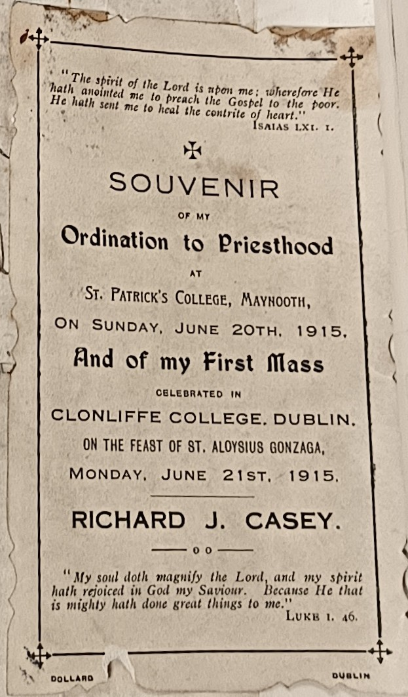
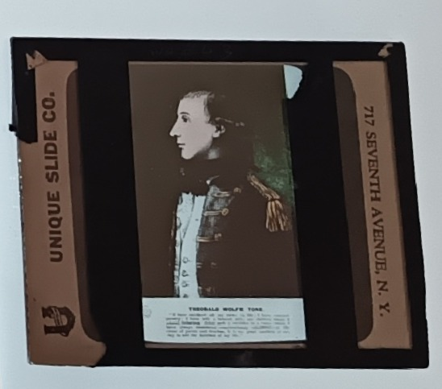
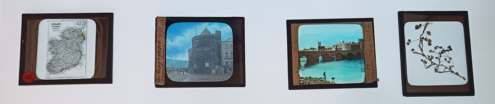
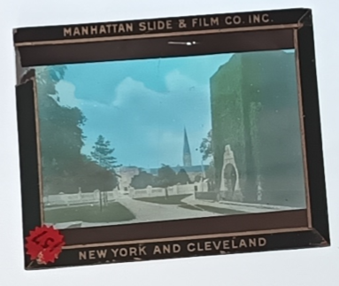

Ordination



#### Arrival in New York

```         
"[He is] one of the finest young priests I have ever come across and all the parishioners are simply crazy about him.""
```

**Dick's ordination was in the summer of 1915 and of course he had to be posted somewhere. It is likely that there were simply no spots available in the heavily subscribed parish of Dungarvan, and he would never again live in County Waterford**. **By October, he was posted to Turtle Bay, Manhatten, where he was appointed assistant pastor of St Boniface's Church, on what is now part of the UN headquarters, as the church was controversially demolishd in the 1950s to make way for the UN expansion.** **Explain more about the nature of the parish (e.g. Irish, German etc)**

**Dick very much hit the ground running and he doubled the church-going attendance of one sodality and trebled that of another. This was no doubt an effort to implement the goals of the man who appointed him, John Cardinal Farley, the Irish-born Catholic Archbishop of New York who became famous for his consolidation of the archdiocese as a powerful civic and religious force. Dick went round the houses, knocking door to door and having a word with anyone who had stopped attending mass regularly.**

## Beautiful Ireland


**The slides that Casey chose portray a land of "emerald hills, the castles of ancient prestige, as well as the modern cities, towns, people and social customs of the old land', according to one contemporary newspaper report. We have a map of the unpartitioned island, some shrivelled up shamrocks, and meticulously preserved castles dating from an ancient time that must have seemed barely fathomable to his New World audience. There's The Rock of Cashel, a round tower on Devinish Island in Fermanagh, and the rope bridge near the Giant's Causeway. Casey includes some images of County Watarford, including the Historic Town of Lismore, Reginald's Tower in Waterford City, and his own parish church in Dungarvan. There's an image of a thatched cottage and one (I didn't see) of Croagh Patrick, a pilgrimage site. There's a notable lack of barren wild landscapes of the kind Americans like to visit nowadays (e.g. the Ring of Kerry, The Burren, Donegal, etc). There is one of Kilkee in West Clare but I see it either so I don't know if it's a photo of the town or the nearby landscapes.**

## Friends of Irish Freedom

{fig-align="center"}

It is interesting to note Casey's choice of rebels and reformers. One slide shows Wolfe Tone, who led the failed rebellion of 1798. Another shows the Wicklow Parliamentarian, Charles Stewart Parnell, his deceased body lying in state. Finally, there is bronze statue of [Fr William Casey](https://www.dib.ie/biography/casey-william-a1544) in Abbeyfeale, Co. Limerick, the "peoples' priest". This Casey – who is also no relation to our subject – must have functioned as quite the role model for our Richard. He was a Gaelgeoir, a musician, a GAA man, and temperance activist, which I suspect Fr Richard was too. Fr William was most active in the Land League, for which he gained huge local support, and so too was Fr Richard's uncle – another Fr Richard J Casey – to whom I shall one day return. There are no slides related to the Fenian Uprising of 1867, even though its veteran John Devoy had become the leading Republican in New York by the time of Casey's lectures. This may be because the Fenians tried to keep a low profile and used codenames for their gatherings. Plus the audience may simply have been familiar with Devoy or the recently-deceased O'Donovan Rossa, and would thus have had no need to slides of them.

**The Fr Casey Collection**



-   After twenty-five years as a chaplain with the Irish Defence Forces,

-   Monsignor Rev Richard J Casey moved to Skerries where he lived the remainder of his life as Parish Priest in the prosperous seaside village that was popular among flocks of holidaymakers.[^boniface_era-1]

-   After his passing, Casey left behind him a collection of photographs and slides which he had amassed over the course of his eventful life

-   This collection sat the church gallery from 1960 until the mid-1990s when the curate gave it to John Harte, of the Skerries Historical Society, and, in 1995, Harte gave the society an oral presentation on the life of Monsignor Casey, with the aid of an ancient projector which he acquired from a nonagenarian priest in Maynooth who was, curiously, also called Fr Richard Casey, a polymath and lecturer in chemistry, who actually made the projector himself.

[^boniface_era-1]: Skerries is, according to Flann O'Brien, "a small, pretty watering-place twenty miles north of Dublin with an ample, sandy strand very safe for youngsters, a spot for deep-sea swimmers on a rocky headland, and round the corner a neat little harbour". The best known resident during Casey's time would have been the fictional James Joyce who, according the O’Brien’s post-modern novel, *The Dalkey Archive*, was alive and well in the and living out his days in the town as an assistant publican, also known as a curate, a pun which leaves the fictional Joyce doubling up as assistant to the local parish Priest, our very own Very Reverand Monsignor Richard J Casey.

{fig-align="center"}

Lantern slides are little pieces of glass, almost square in shape, which can be viewed without projection as they are positives, not negatives. Their sides are, at most, 3 inches long, so it can be hard to make out finer details, but that's not a worry for me today as I only want to know what the subjects are. The slides would have been created by specialist companies, and in the example above it was *The Manhatten Slide & Film Co Inc*, who added artificial colour to the original black and white photos, just as we might use an AI tool to recreate the colour in our old photos and videos. The slides in the collection were made by many different companies – which we know because their names are branded into the frame around the image – and this suggests Casey was all the time amending his presentations, and adding to his collection.

Nora tells me that lantern slides were used for a range of familiar practices, mostly education and exhibitions. They would have been common in universities and perhaps the wealthier schools, and also used by rich people to show off their holiday snaps, just as we would do online nowadays. They were particularly popular for religious instruction, which might be why Casey was so familiar with the practice, making a simple shift from teaching his flock towards lecturing them on political revolution.

#### Departure from New York

One of the greatest curiosities of the RJC's return home from New York was that he had his car boxed up and sent home in advance of his own departure. It is not clear exactly why RJC had his own car as it was still unusual for a priest to have his own vehicle, especially in a densely-packed city such as New York. A parish church might own a car for use among its priests, but not usually the priests themselves. Car ownership would have been more common among rural priests with need to cover greater distances. It is thus a marker of how financially savvy RJC must have been, although questions might be asked of how he amassed the cash needed for a vehicle of his own. Obviously it would be an unfair and huge jump to connect his personal wealth to the fact that he was involved in fundraising throughout his time in New York, although that hardly simplified his finances. We must remember that he grew up in a family of shopkeepers who must have kept close tabs on all finances - daily, weekly, annual – while, being the eldest in the family, RJC must have been well trained by his father.

It is worth noting that the scrapbook contains a lengthy letter from the Archbishop of New York, John Cardinal Farley, advising pastors on how to keep their finances in order. Modern readers will be astonished to know that only 2% Federal Tax was being charged on higher earners, with a further new deduction of 2% due to the War Revenue Act, although this was graded higher for higher earners.

So while we details may not all be clear, we do know that RJC was not afraid to drive a bargain and ask for a discounted rate. His car was shipped home at half price because the shipping company, Moore and McCormack were willing to oblige and even go out of their way. Normally, they seem to have been shipping government goods, including various kinds of boxed up vessels, but these were not their own boats so they couldn't control the rates. However, the *Nyanza* was a steamboat owned and operated by the company itself, sailing directly from Brooklyn to Dublin, where he would live for the rest of his life.

## **Being home**

-RJC Moves to 21 Elm Grove, Ranelagh

-   Rev RJ Casey BA, chaplain to Roebuck Convent, Co Dublin,

<!-- -->

-   1920 - returned to ireland - Bray

Moving home must have been sweet-sweet-bitter for Casey. It was doubly sweet because he was not just returning to the Auld Sod, as any emigrant might be happy to do, but because he was returning to a country that was soon to achieve a freedom that he and his people had been actively fighting for. Yet the bitterness is something that may have been slower to develop and it might only be in my imagination or interpretation of his life. It seems to me that Dick's vivacity, which was so apparent in New York as soon as he arrived, may have dissipated across his mature career in Ireland due to the tininess of the country and the inertia that stifles those with talent. Dick was clearly a man able for great things and in New York there was simply greater opportunity than in the smallness of Ireland with its tiny population and its surplus of priests who were, in retrospect, being churned out like they were going out of fashion. In Dick's era, there were three Irish-American cardinals in the USA and none at home, **(enumerate)**.

The bittersweet sweetness of Dick's return was elequently mirrored through the tears and and smiles of his very close friend, Patrick J McNamara of the Military Band and Orchestra, with whom RJC worked very closely throughout his time in New York. McNamara was so happy to hear from his very close friend but was clearly sad at losing such a close working partner, and of course back then it was not clear if or when friends across the pond would see each other again. As for RJC, the sweetness is two-fold, coming from the simple joy of being home on the auld sod, but also from the enormous political developments of the day. McNamara's letter was sent just two days after the truce and ceasefire between Irish and British sides. Thus he makes reference to the 'newly free and happy Ireland' in which RJC was now living, and neither could have known that it was a condition that was sadly not to last. Yet there must have been deep sadness for RJC at giving up on so much that he had developed in his energetic years in New York. For McNamara, the focus is in music, the basis of their relationship, and he notes that St Boniface's parish have had no entrants to the Feis Ceoil since RJC departed, while they were winning gold and silver medals while he was there. It is not so much the musical ability of RJC which is missed here, but his rousing qualities, getting students enthused so that professionals like McNamara could get them up to the level required.

For RJC, his return home feels like the begining of the end for him. It is as though something died in him. The vivacity reduces

**Austie as contrast to Dick - because he found the one area of prosperity in Irish life in the 19th Century**
