Unsorted notes

IMG_20251106_115945.jpg

-   Letter for Testimonial for widow of PJ Collins

-   American Fraternity Sons of Erin

    -   <https://www.nytimes.com/1923/06/15/archives/irish-sympathizers-to-fight-agitators-american-fraternity-sons-of.html#>

    non-sectarian fundraising for Ireland

    long list of nams in the article above

IMG_20251106_120537.jpg

Aug 7, 1922

Michael J Curley becomes Archbishop of Baltimore

<https://www.notion.so/2025-11-21-Friday-2b24cfb36164803c84bacfd04c7825a1#2b34cfb361648019a4f5e30c3ebc42af>

**ull name:** John Joseph Dunn

<https://en.wikipedia.org/wiki/John_Joseph_Dunn>

1916 - investigation into him in NYC

*During his first 17 years as director, he raised over \$2 million for Catholic foreign missions.[\[6\]](https://en.wikipedia.org/wiki/John_Joseph_Dunn#cite_note-6)*

-   

-   **Full name:** John Joseph Dunn

-   

-   **Born:** September 1, 1870, New York City

-   

-   **Died:** August 31, 1933, New York City

-   

-   **Role:** Auxiliary Bishop of the Archdiocese of New York

-   

-   **Title:** Vicar General (second-in-command to the Archbishop)

-   

-   **Ordained as priest:** May 30, 1896

-   

-   **Consecrated as bishop:** October 28, 1922 by Archbishop Patrick Hayes

-   

-   **Burial:** Dominican Sisters Cemetery, Newburgh, New York

-   

The person who signed this letter is Bishop John Joseph Dunn, who served as Vicar General and Auxiliary Bishop of New York from 1921 until his death in 1933.

### Friends of Irish Freedom vs. American Committee for Relief in Ireland

## Friends of Irish Freedom

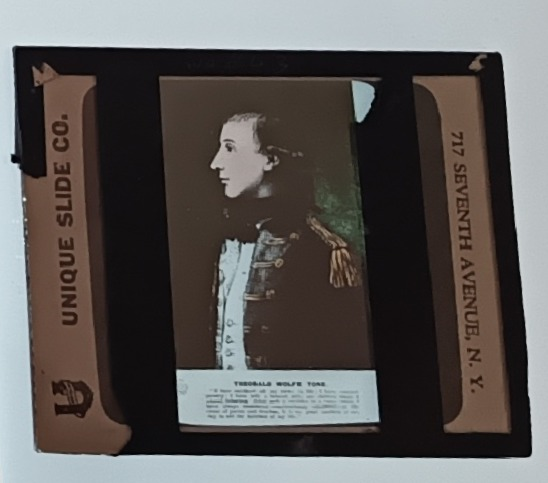{fig-align="center"}

It is interesting to note Casey's choice of rebels and reformers. One slide shows Wolfe Tone, who led the failed rebellion of 1798. Another shows the Wicklow Parliamentarian, Charles Stewart Parnell, his deceased body lying in state. Finally, there is bronze statue of [Fr William Casey](https://www.dib.ie/biography/casey-william-a1544) in Abbeyfeale, Co. Limerick, the "peoples' priest". This Casey – who is also no relation to our subject – must have functioned as quite the role model for our Richard. He was a Gaelgeoir, a musician, a GAA man, and temperance activist, which I suspect Fr Richard was too. Fr William was most active in the Land League, for which he gained huge local support, and so too was Fr Richard's uncle – another Fr Richard J Casey – to whom I shall one day return. There are no slides related to the Fenian Uprising of 1867, even though its veteran John Devoy had become the leading Republican in New York by the time of Casey's lectures. This may be because the Fenians tried to keep a low profile and used codenames for their gatherings. Plus the audience may simply have been familiar with Devoy or the recently-deceased O'Donovan Rossa, and would thus have had no need to slides of them.

In my next post, we will see that Casey's talks may have been part of a series of covert funding campaigns for the Revolution.. For example. one 1919 soirée saw both a céilidhe and Casey's (music-filled) presentation. It was held by the Gaelic Society in New York. We shall also see newspaper reports of how Casey's was not afraid to include his thoughts on the English oppressors of the Irish people.

## 

1915 starts lecturing

-   weave in the Beautiful Ireland and revolutionary stuff here

-   I want to talk about the Revolutionary nature of these talks. Their subject matter, the venues and the newspaper reports, mostly based on newspaper clippings that Casey kept, but also based on more general research into the topic of funding drives in America.

-   **It is not clear how many talks Casey gave but we have newspaper clippings of several lectures between 1917 and 1919. I can't yet work out exactly when the talks became heavily politicised, but in 1916 there were reports of him giving 'Lenten Sermons' about the religiosity of Irish faithful back home**

-   It is not clear exactly when Casey began giving presentations with slides, but there is one clipping from 1916 which reports him giving 'Lenten Sermons' about the religiosity of Irish faithful back home. By 1917, he is talking about life in Beautiful Ireland, as we know from his slides. But his talk has also been politicised a lot, and *The Gaelic American* reports that "

    ```         
    "[Casey] took occasion at every appropriate time, to demonstrate alleged pernicious results of English misrule in the country."
    ```

    Clearly, the audience were on the same page as the reports that:

    ```         
    The photographs of Easter Week, 1916, were wildly applauded. 
    ```

    One such name was The Gaelic Society, and by January 1919, Casey was presenting at one of their céilidhthe, a combination that shows how revolutionary fervour could be drummed up amidst a cultural event, and a reminder that the Irish cultural revolution really holds primacy over the political revolution.


Among the revolutionary fervour, there are slides of Wolfe Tone who led the failed rebellion of 1798, Parnell's body lying in state, and the bronze statue of [Fr William Casey](https://www.dib.ie/biography/casey-william-a1544) in Abbeyfeale, Co. Limerick. This Casey – who is no relation to our subject – must have been quite the role model for our Richard. He was a Gaelgeoir, musician, GAA man, and temperance activist, which I suspect Fr Richard was too. Fr William was most active in the Land League, for which he gained huge local support, and so was Fr Richard's uncle – another Fr Richard J Casey – to whom I shall one day return. There are no slides related to the Fenian Uprising of 1867, even though its veteran John Devoy had become the leading Republican in New York by the time of Casey's lectures. This may be because the Fenians tried to keep a low profile and used codenames for their gatherings.

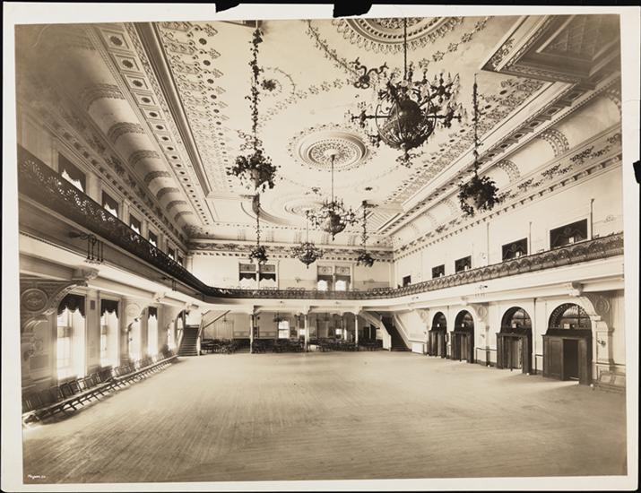

Casey's lecture to The Gaelic Society was about 'The Irish Brigade", a term used to refer to each sub-unit of the Irish Republican Army, and in May 1919 he was performing at The Central Opera House for between 1200 and 1800 listeners. This venue was used for 'ethnic theatre' and it occasionally showed [films about Ireland.](https://nyirishhistory.us/article/ethnic-cinema-in-nickelodeon-era-new-york-city/)

-   

-   **Friends of Irish Freedom (FOIF)** was founded in 1916 as a broad-based Irish-American nationalist group. It was closely aligned with **Clan na Gael** and supported the 1916 Rising and Irish independence. FOIF raised **over \$350,000** for Irish causes through the Irish Relief Fund [Wikipedia](https://en.wikipedia.org/wiki/Friends_of_Irish_Freedom).

-   

-   **American Committee for Relief in Ireland (ACRI)** was formed in 1920 to provide humanitarian aid during the War of Independence. It focused on **non-political relief**, but many of its members were sympathetic to the nationalist cause [Cambridge University Press & Assessment](https://www.cambridge.org/core/journals/irish-historical-studies/article/abs/american-committee-for-relief-in-ireland-192022/23909DF7F637B7F3FBF6FB8E7234A64D) [JSTOR](https://www.jstor.org/stable/30008232?read-now=1).

-   

-   **Tensions arose** between FOIF and ACRI over control of funds and messaging. FOIF wanted to ensure money supported independence, while ACRI emphasized neutrality and humanitarian aid. This led to **splits in Irish-American support networks**, especially in New York.

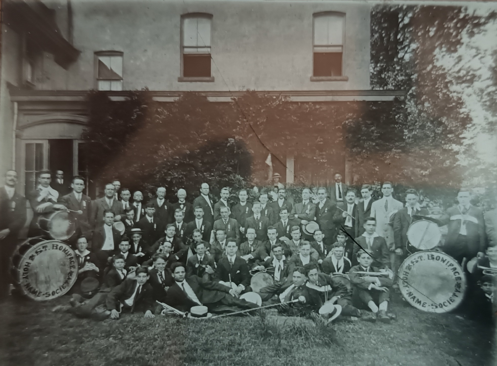{fig-align="center"}

It's important to note here that these events were not dull lectures, but an 'illustration' of Ireland 'in picture, song and story'. Clearly, Casey was an experienced orator from his sermons, but he was a keen musician and collaborated above with Professor Patrick J McNamara who **(need to confirm)** ran the St Boniface Holy Name Society band. The photo above shows their band – taken from a lantern slide – and, a couple of years after Casey returned home, McNamara wrote to him to lament that there were no more pupils entering the Feis Ceoil. In Casey's time, his pupils won gold and silver medals. Clearly the band were an ideal segue between the talk and the céilidhe.

The music would have had the other function of rousing the audience's political sentiments and encouraging them to donate. In the same month as Casey's talk in the Central Opera House, there were reports of \$19,000 being raised in New York for the Irish cause. No doubt that increased over time as about a quarter of a million would be raised in America for the First Dail Loan. Casey himself contributed to this which we know because his scrapbook contains receipts of the bonds he himself bought. But his role was not as a financial contributor, but as a trusted man of influence who could rouse others to donate their cash.

### Bishop John J. Dunn and the 1916 Investigation

-   

-   **John J. Dunn was Vicar General of New York** and later Auxiliary Bishop (1921–1933). He was a powerful figure in Catholic administration [Wikipedia](https://en.wikipedia.org/wiki/John_Joseph_Dunn).

-   

-   While **no direct scandal involving Dunn in 1916** is documented, that year saw **increased surveillance and political tension** in New York. The NYPD and federal agents investigated Irish nationalist groups, including FOIF and Clan na Gael, for suspected ties to Germany and revolutionary plots [The New York Times Web Archive](https://archive.nytimes.com/iht-retrospective.blogs.nytimes.com/2016/05/19/1916-police-tapped-phone-lines/).

-   

-   Dunn’s role as Vicar General meant he likely **oversaw or was aware of fundraising activities** by priests like Fr. Casey. The Catholic Church walked a fine line between supporting Irish independence and avoiding political entanglements.

-   

So it looks like RJC bought a handful of bonds himself , \$50 to begin with, and \$10 twice later.

In today’s money that seems to be \$70 x 60 = \$42000

See Patrick O’Sullivan Greene for more

*. The low serial numbers suggest early participation. (copilot)*

------------------------------------------------------------------------

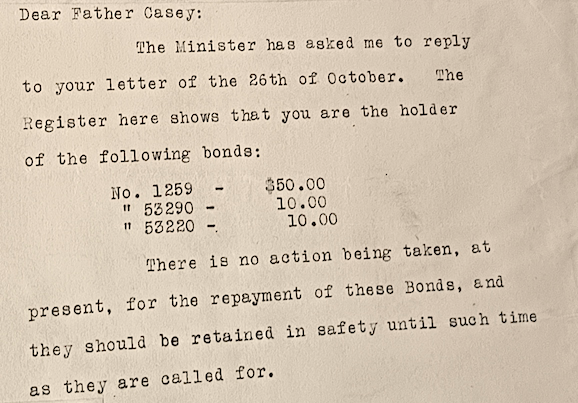

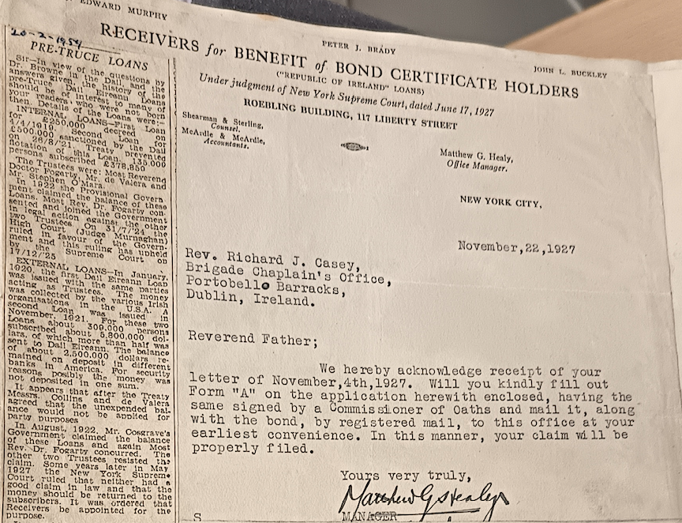

IMG_20251106_115609.jpg

**My dear Father Richard,**

Very pleased indeed to hear from you, even though your letter deals with a matter in which I fear I can give little help. The details you give are altogether too meagre. I have the name, either real or feigned, but in only one case was it remarked that was the case of a family, with county address, the location of a small property in Ireland, and likely the fact that many are seriously interested & inquiry is that word used. I think normal civil inquiry, if the happy result had the family been resident & applying in a city of over a million people, they would possibly have remained undiscovered.

With very kind wish and blessing, I am, my dear Father Richard, **Faithfully yours,**  **W.H. Stokes, Archbp**

*The inquiry is in the hands of Very Rev. Dean Canaday, Pres. St. Mary's Cathedral, Sydney.*

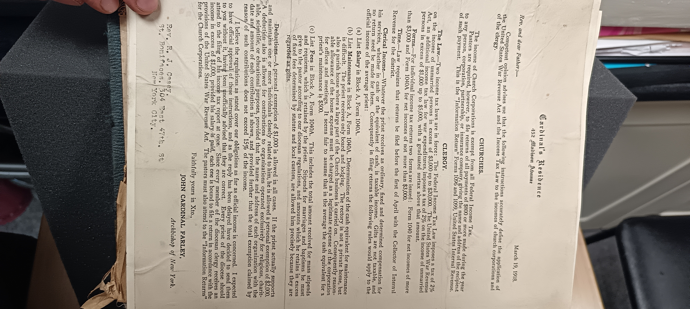

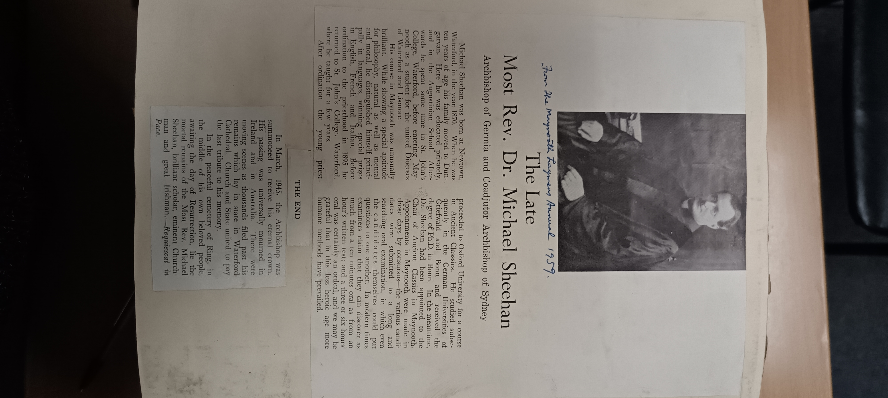

**Influences on RJC**

*RJC stayed close to his many influences and was in regular contact with many of those he was taught by...*

IMG_20251106_114815.jpg

REv Michael Sheehan, buried in Ring, b 1870,

Must have had an influence on Richard

-   St John's College Waterford

-   Serious Scholar in his day

-   Coadjutor Archbiship of Sydney

------------------------------------------------------------------------

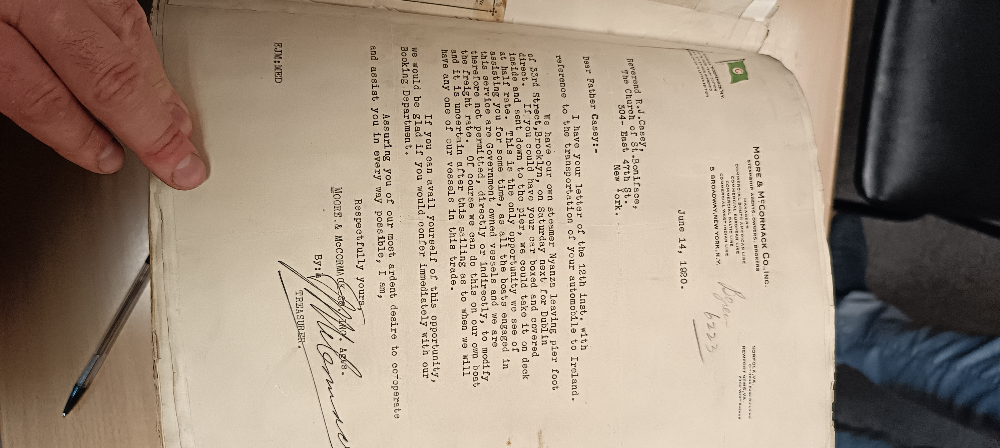

Ordained 1915,

IMG_20251106_115124.jpg May 23, 1921

-   letter from Robert F Keegan

-   114 East 47th St (down the road)

-   knows RJC would rather be in Dublin than New York

-   then lists off a bunch of accounts. wer’re talking \$839k so a lot of money

-   Recent appeal of the American Committee for relief of widows and orphans in Ireland

<https://iar.ie/archive/letters-american-committee-relief-ireland/>

<https://en.wikipedia.org/wiki/American_Committee_for_Relief_in_Ireland>

<https://www.cambridge.org/core/journals/irish-historical-studies/article/abs/american-committee-for-relief-in-ireland-192022/23909DF7F637B7F3FBF6FB8E7234A64D>

This relief fund of \$838k is more than double the First DAil Loan

H. E. Glover

Structure

photo 120108 has a write up about RJC's early life

**Education**

-   **CBS**

<!-- -->

-   **Christian Brothers SChoool,**

-   **Augustinian Seminary in Dungarvan**

-   **Mount Melleray Seminary in Cappoquin (along with Joseph) - - matric and First Arts in the Royal Uni of Ireland**

-   **Complete Uni in Holy Cross College, Clonliffe Rd ... Clonliffe College, Dublin**

-   **The National University of Ireland**

    -   **graduated from the univeristy in the first year the uni was empowered to confer degress**

    -   **later entered theological school**

    -   **Theological Course in Maynooth &**

-   **pre-1915 Maynooth**

    -   **buncha Sinn Fein people**

    -   **Michael Casey memories of Ordination in Maynooth**

        -   **another person recalls Sports Day in Maynooth**

        -   **A reminder of RJC's time**

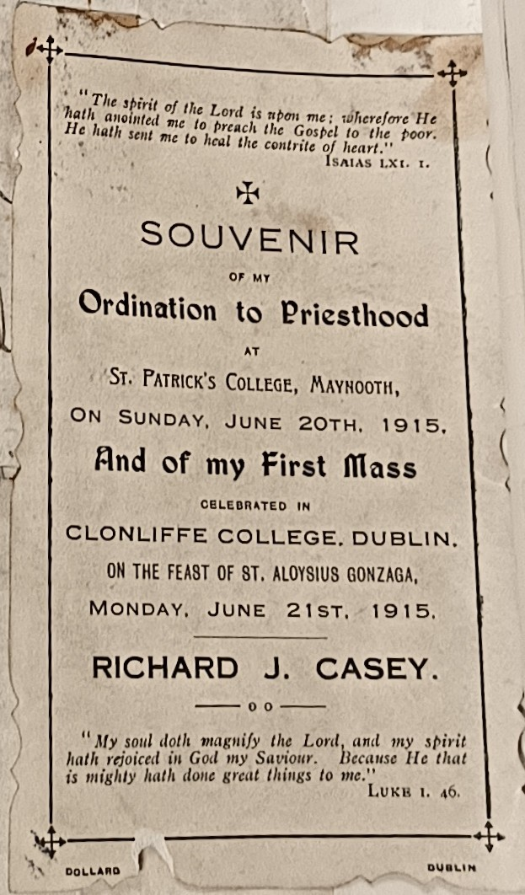

-   **Ordained to the priesthood in Maynooth**

    -   would have been common (for some reason) for Waterford \* Lismore priests to pursue priesthood abroad

-   **assistant pastor of St Boniface's RC church, 47th ST & 2nd Avenue**

    -   **appointed by Cardinal Farley, as assistant to REv FXE Albert, pastor of ST Boniface**

    -   **St Bonifaces 304 East 47th St NYC**

        **Demolished c1950** <https://en.wikipedia.org/wiki/St._Boniface_Church_(New_York_City)>

**1915**

-   **starts lecturing**

**IMG_20251106_115102.jpg**

**Letter to John White in Dungarvan from NYC saying how good RCAsey is at rounding up a congregation**

-   **arrived two months before December**

-   **Dec 12, 1915**

-   clealy a great organizer from the off

-   **"one of the finest young priests I have ever come across and all the parishioners are simply crazy about him".**

-   **full of energy**

-   **double the membership of one sodality and trebled the other, adding about 20 a week.\
    Goes around the houses and talks to any non-massgoer.**

-   not an idle bone in the man's body

**Fundraising**

-   War Saving & Liberty Bonds

    -   Childrem of St Boniface School has been selling Liberty Bonds and War Saving stamps - contributing 100s of \$\$s in Thrist Stamps

-   img-5785

-   Exit testimonial

    -   friends, parishioners and members of the united societies

        -   bunch of names listed worth investigating, including:

            -   PJ collins, treasurer of United Irish Societies

            -   Thomas rock, president of St Coman's brnach of FOIF

-   Various church societies

    -    holy name

    -   juniour holy name

        -   larger clubhouse in thenear future

    -   the band escorted so many of our heroes to victory during the recent war and which everyone knew as "Fr Casey's band"

        -   won second prize in open competition with the bands of new york City at Fordham grounds in 1919

-   Holy Name Society

    -   increasd membership by 400% (quintupled) in his five years

-   <div>

    -   pened its doors to returning soldiers

    </div>

    -   music, writing, reading, billiards and other forms of amusemtn

    -   soldiers from debarkation hospital no 4 are frequent visitors to the parish auditorium

    -   293 of the congregation went to fight for America in WW1, 165th infantry

        -   i wonder if this gave him experience to become military chaplain

        -   Knights of Columbanus Drive raised \$11000

## 1917

Irish Relief Fund Bazaar

-   Madison Sq Garden

-   for the benefit of the families of Irish martyrs and prsisoners

-   October 1917 - eight days long, 10hrs per day. That's a lot

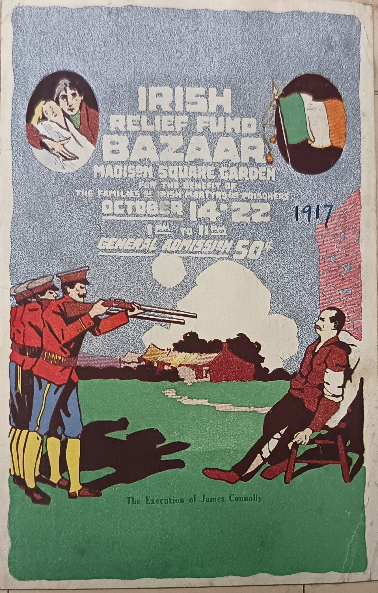


IMG_20251106_120815.jpg

Powerstown?? **Clonmel** **1-1-1917**

My dear Dick, Thanks for yours of the 4th Dec – as also for enclos\[ure\] of £3.10.0, which I have forwarded to ???**Ramey** to discharge, as I'm filled up, having got a bequest of £25.0.0 within the past 3 weeks. I have not issued any Xmas Cards for years past & hence you won't be disappointed. I'm proud to learn that you are doing good work. Your loving Uncle

## **1919**

Feb 26, 1919, Beautiful Ireland Ferry??? Maennaercher Hall

1919

-   RJC to write sermon for the editorial page of New York Herald on 25 May 1919

IMG_20251106_114808.jpg

March 19, 1918

Rev Richard gets a letter about Federal tax payments. Why?

From the Archbishop of New York, John Cardinal Farley

Rev Richard Casey

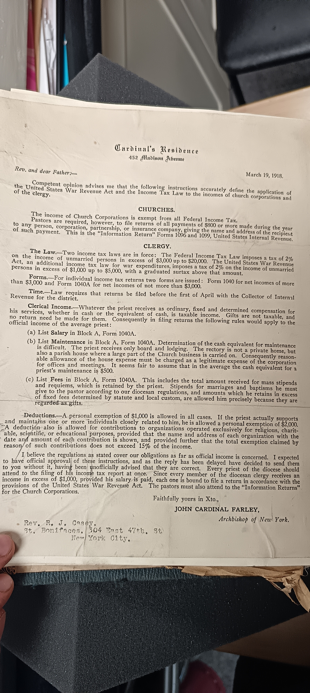

## **RJC is leaving New York**

July 17 1920, big write up on him, some interesting names involved and also a great mention of United Irish Societies etc.

#### Impromptu Testimonial?

-   Assistant priest at St Bonifaces

<!-- -->

-   Capacity crowd

    -   parishioners,

    -   members of united socieites

        -   PJ Collines, treasurer of United Societies

    -   friends

-   rarely was such a spontaneous and enthusiastic gathering seen

-   Appointed by Cardinal Farley nearly 5 years before

    -   increase int he membership of the Holy Name Societies

    -   Spiritual Director of these and others

    -   organized Holy Name band

-   Beautiful Ireland talks

-   Rosary in Irish

-   Music

    -   

    -   1918 two gold and three silver medals at the Gaelic Feis

-   Alderman Collins said that CAsey was to bring back the message that they wish the Irish people well in their struggle for freedom

"homelike surroundings" for CAsey in St Boniface's church (since demolished congtroversially)

-   followed by dancing and a few arias on the war pipes

    -   Killarney

    -   Meeting of the waters

    -   Star Spangled Anthem (as finale, with everyone standing)s

------------------------------------------------------------------------

[**P. J. Collins**](https://www.notion.so/2025-11-24-Monday-2b54cfb361648055870ad16f0c56f5d5?source=copy_link#2b54cfb3616480cda84ac8917d511c7d) was a leading figure in the United Irish Societies around 1918, an umbrella organization in Dublin that coordinated nationalist commemorations and cultural events, especially those honoring the 1798 and 1916 traditions. He acted as an organizer and spokesman, helping to keep nationalist memory alive during a politically volatile period.

he **United Irish Societies (UIS)** was a federation of nationalist clubs, cultural groups, and commemorative committees in Dublin.

He gives thanks to the Parishioners and the United Societies

There is 100% defo a strong connection here with the fundraising.

### **Bringing his car home, June 1920**

IMG_20251106_115114.jpg

Moving his car home to Ireland, June 14, 1920 (after this date)

Moore & McCormack steamship agents!

**One of the greatest curiosities of the RJC's return home from New York was that he had his car boxed up and sent home in advance of his own departure. It is not clear exactly why RJC had his own car as it was still unusual for a priest to have his own vehicle, especially in a densely-packed city such as New York. A parish church might own a car for use among its priests, but not usually the priests themselves. Car ownership would have been more common among rural priests with need to cover greater distances. It is thus a marker of how financially savvy RJC must have been, although questions might be asked of how he amassed the cash needed for a vehicle of his own. Obviously it would be an unfair and huge jump to connect his personal wealth to the fact that he was involved in fundraising throughout his time in New York, although that hardly simplified his finances. We must remember that he grew up in a family of shopkeepers who must have kept close tabs on all finances - daily, weekly, annual – while, being the eldest in the family, RJC must have been well trained by his father.**

Tax Letter 1918 IMG_20251106_115945.jpg

**It is worth noting that the scrapbook contains a lengthy letter from the Archbishop of New York, John Cardinal Farley, advising pastors on how to keep their finances in order. Modern readers will be astonished to know that only 2% Federal Tax was being charged on higher earners, with a further new deduction of 2% due to the War Revenue Act, although this was graded higher for higher earners.**

**So while we details may not all be clear, we do know that RJC was not afraid to drive a bargain and ask for a discounted rate. His car was shipped home at half price because the shipping company, Moore and McCormack were willing to oblige and even go out of their way. Normally, they seem to have been shipping government goods, including various kinds of boxed up vessels, but these were not their own boats so they couldn't control the rates. However, the *Nyanza* was a steamboat owned and operated by the company itself, sailing directly from** **Brooklyn to Dublin, where he would live for the rest of his life.**

## **Being home**

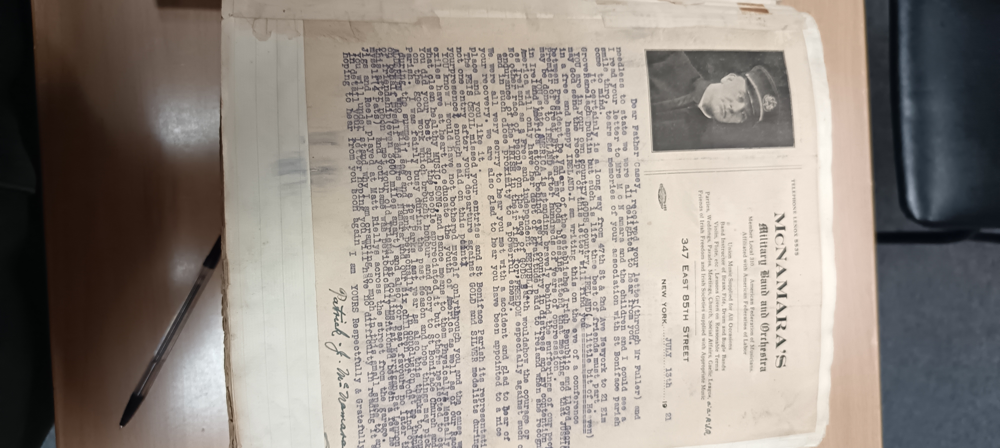

**July 13, 1921**

Macnamaras Military Band & Orchestra

347 85th st

47 min walk away

RJC had an accident

‘the best of friends must part’

Still seem to looking for USA to recognise IReland

Lots of music chat

met your old friend Pat COllins, Pat Kerrigan, Pat Lennon & myself (4 Pats)

**Moving home must have been bittersweet for Casey, a situation that is elequently mirrored through the tears and and smiles of his very close friend, Patrick J McNamara of the Military Band and Orchestra, with whom RJC worked very closely throughout his time in New York. McNamara was so happy to hear from his very close friend but was clearly sad at losing such a close working partner, and of course back then it was not clear if or when friends across the pond would see each other again. As for RJC, the sweetness is two-fold, coming from the simple joy of being home on the auld sod, but also from the enormous political developments of the day. McNamara's letter was sent just two days after the truce and ceasefire between Irish and British sides. Thus he makes reference to the 'newly free and happy Ireland' in which RJC was now living, and neither could have known that it was a condition that was sadly not to last. Yet there must have been deep sadness for RJC at giving up on so much that he had developed in his energetic years in New York. For McNamara, the focus is in music, the basis of their relationship, and he notes that St Boniface's parish have had no entrants to the Feis Ceoil since RJC departed, while they were winning gold and silver medals while he was there. It is not so much the musical ability of RJC which is missed here, but his rousing qualities, getting students enthused so that professionals like McNamara could get them up to the level required.**

**For RJC, his return home feels like the begining of the end for him. It is as though something died in him. The vivacity reduces**

-RJC Moves to 21 Elm Grove, Ranelagh

-   1920 - returned to ireland - Bray

## 1921 Bray

Rev RJ Casey BA, chaplain to Roebuck Convent, Co Dublin, has been appointed curate in Bray Parish

-   

    -   an additional appointment due to the growth of the catholic parish of Bray in recent yeaars

    -   Wicklow Pwopel 12/12/1921

-   organizes train trips to Waterford with the Temperance Society

-   Cancelled in Aug 1922 due to death of Collins

#### **1922**

**IMG_20251106_115455.jpg**

**Episcopal Residence**

**St. Augustine, Fla., June 20th 1922**

My dear Dick:

I thank you for your kind letter of good wishes and congratulations. The conversation occurred so long ago that at this time it appears no more than a memory. I feel like an old veteran at present as many things have happened in the past few months to try the mettle of the new Bishop Fla. We are now beginning to settle down to real constructive work so that when you visit us again, you'll notice quite an increase in church activity in Fla. I am rejoiced to hear that the cloud over Erin is passing, & hope all parties will join in laying the foundation of the most peaceful & prosperous government on earth.

With every best wish & blessing for yourself and hoping to see you again in the not too distant future.

I am,

Yours faithfully,

**J. J. Barry (name?\_**

**IMG_20251106_120457.jpg**

**Bray & Temperance movement**

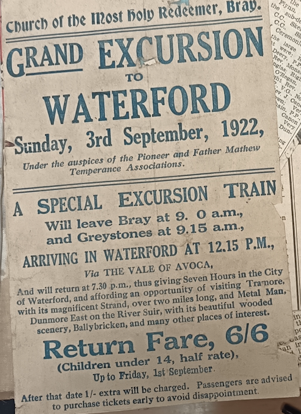

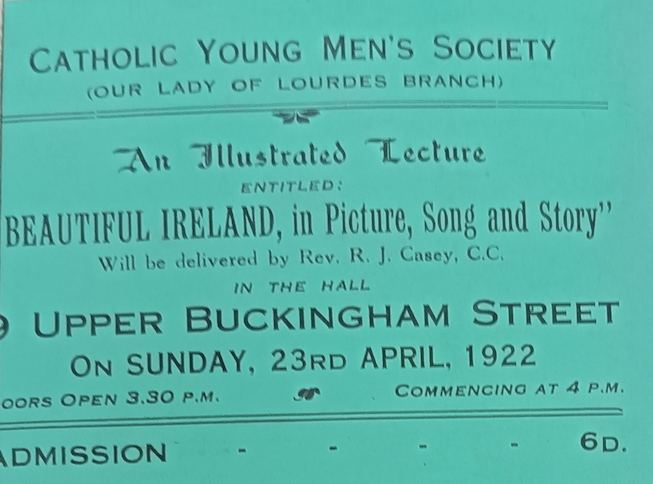

March 1922 (post-Truce, pre-Civil War)

Big funeral in Bray

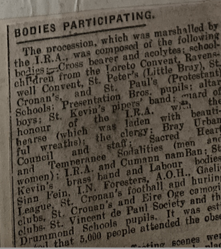

What “marshalled by the IRA” likely meant

In a March 1922 Bray funeral, this would typically involve:

-   Uniformed or semi‑uniformed Volunteers lining the route

-   IRA stewards managing the procession

-   Possibly a firing party (if politically appropriate)

-   Flags, bands, and republican banners

-   Senior IRA officers attending as a mark of respect

-   

-   A series of lantern slide lectures - by Opening a Young Men's Club in New York, helping the Gaelic Leagure

    -   orator skills in deman at Religious and social functions

-   

-   

IMG_20251106_120624.jpg

0ct 22, 1922

“Interesting Wedding”

Church of St Michael, Dun Laoghaire

Mr Joseph HP Collins — of Tramore, Waterford & cousin of RJC — marries Isobel Maguire of Sunnymeade, Clones, widow of the late John Maguire, solicitor, of Lisnakea (Enniskillen)

Collins seems to be abandoning his American Citizenship. He declares marriage intentions as soon as the Treaty was ratified.

Seems to be well known in London Irish Circles

Circles RJC is mixing in now — another priest is from the Pro-Cathedral

The party breakfasted in Royal Marine Hotel in Dun Laoghaire

Attendees listed
