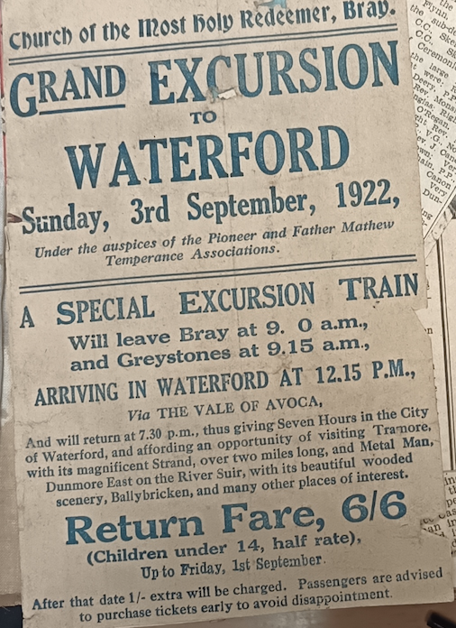
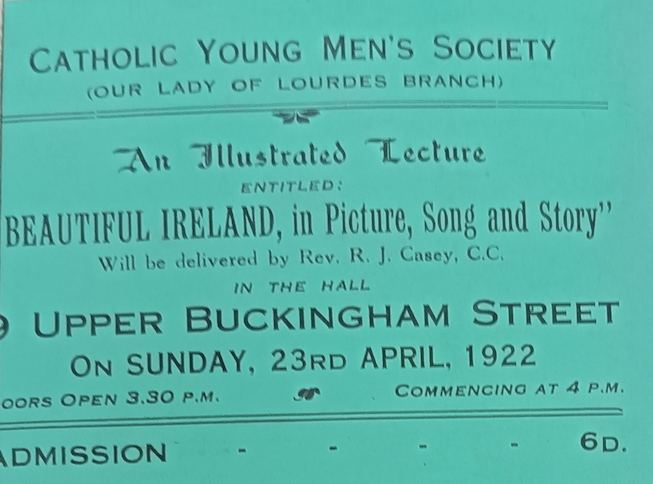
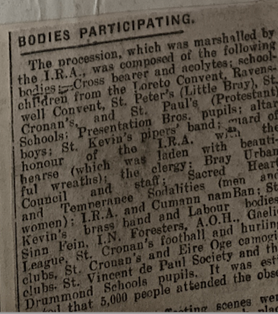
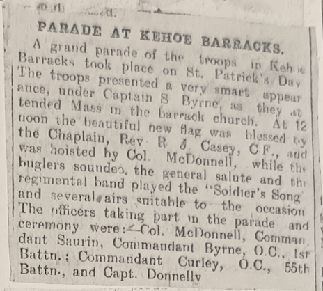
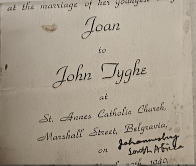
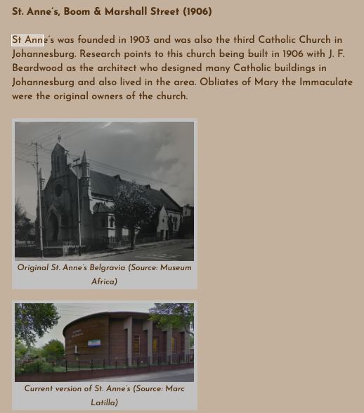
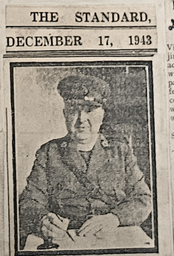
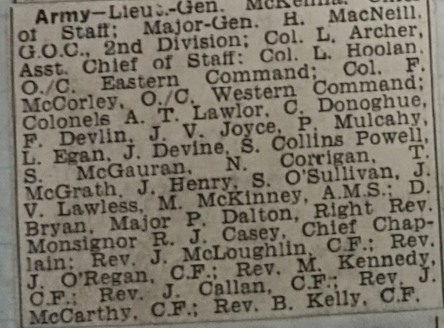

-   Question: how many journeys did RJC make back and forth to the states?

    -   1931 Joe's wedding oct 23 1931

    -   1951 Joe Celebration

    -   South Africa trip

## 1921 Bray

Rev RJ Casey BA, chaplain to Roebuck Convent, Co Dublin, has been appointed curate in Bray Parish

has been appointed curate in Bray Parish

-   

    -   an additional appointment due to the growth of the catholic parish of Bray in recent yeaars

    -   Wicklow Pwopel 12/12/1921

    -   



-   organizes train trips to Waterford with the Temperance Society

-   Cancelled in Aug 1922 due to death of Collins

-   Talks continue





March 1922 (post-Truce, pre-Civil War)

Big funeral in Bray

-   

-   What “marshalled by the IRA” likely meant

In a March 1922 Bray funeral, this would typically involve:

-   Uniformed or semi‑uniformed Volunteers lining the route

-   IRA stewards managing the procession

-   Possibly a firing party (if politically appropriate)

-   Flags, bands, and republican banners

-   Senior IRA officers attending as a mark of respect

-   

-   A series of lantern slide lectures - by Opening a Young Men's Club in New York, helping the Gaelic Leagure

    -   orator skills in deman at Religious and social functions

-   

\
October 1922

-   WEdding of Joseph HP Collins of Tramore & London, Cousin of celebrant RJC

-   

<!-- -->

-   1923 - appointed Chaplain - wond the esteem and affection of large numbers of army personnel from Dungarvan & Waterford areas?
-   IMG_20251106_120537.jpg – chaptain Kehoe Barracks. Stuff being opened

May 25, 1921

Mass for those who died in the Custom House

July 9, 1923

Another sports day in the barracks

Aug 1923 (on father's funeral notice)

Rev R J Casey, Kehoe Barracks, Dublin

25-12-1926

Portobello barracks

A Miss Cantata was sung by RJC

IMG_20251106_120620.jpg

The Passion Play,

March 1923, Kehoe Barracks Gym

Rev Fancis A Gleeson

Sacred music by regimental band

Was RJC involved in the band?

IMG_20251106_120634.jpg

Army Prizes —29/1/1932

Army Prizes 12 -12 - 1929

IMG_20251106_115517.jpg

**George S. Waring**.

He’s in Portobello Barracks Brigade Chaplain’s Office, p

IMG_20251106_120207.jpg

**1925 Christmas masses,**

The Military Churches

-   well worth looking at this pile
-   Arbour Hill
-   Portobello
    -   Rev Richard Casey CF Brigade Chaplain
    -   The Army corps of engineers, Griffith Barracks attended
    -   McKee Barracks
    -   Collins Barracks

How big was the Irish Army

And when was it cut down to its current size?

IMG_20251106_120509.jpg

Mansion House Function for Wounded Soldiers

(Reception + ceilidhe mor)

-   Eoin McNeill, Minister for Eduction

-   Prof M Hayes, Ceann Comhairle

-   

1923 RJC - CHAPLAIN KEOGH BARRACKS

March 19, 1923 (newspaper) Hoisting the flag on St Patrick’s Day. blessed by RJC and hoisted by Colonel McDonnell



IMG_20251106_120514.jpg

RJC blesses a gathering of 800 pioneers in the Church of our lady of Lourdes, Lr Gloucester ST

April 16 1923, Recretion centre opend by RJC in Kehoe Barracks

Kehoe / Richmond Barracks

<https://www.richmondbarracks.ie/ga/about/history-of-richmond-barrcks/history/>

IMG_20251106_120527.jpg

RJC acts as a starter in sports day for the troops

c

IMG_20251106_114753.jpg

 

1927, nov 22

-   letter from NYC with loans being returned

Brigade Chaplain's Office, Portobello Barracks, Dublin, Ireland

#### **1928**

IMG_20251106_115613.jpg

Letter to Fr Casey 1928 looking for girls to enter the nuns without a dowry

German roots of St Boniface’s

Were they seen to be connected

#### **1932**

#### **Ireland’s contribution to the great republic of the west**

RJC - The IRish CAtholic in America 1932 - The Irish independent Eucharistic Congress Number, June 1932

-   This full-page article gives us a snapshot of RJC's philosophy as he outlines Ireland's contribution to the growth of the American nation, dating back as far as the 1650s, up as far as the successes of Irish Americans in the contemporary chruch.

-   It is noteworthy because it perhaps shows us the relevance of his thinking and provides a reminder of his great youthful energy before he became stifled by the tininess of life in the Irish Defense Forces.

-   RJC sees himself as part of a long tradition dating back to the mid-seventeenth century, and the persecution Irish people felt both at home with the penal laws, but often within America itself. He notes that Montserrat in the Caribbean was established in 1633 by Irish Catholics banished from Virginia, but then in the 1650s another 10,000 Irish were banished from their homeland by Oliver Cromwell. RJC lists out various Irish men of power throughout the eighteenth century, including many leaders of the American Revolution, before remarking on the contribution of the Pioneers tramping West across the great continent, maing roads, building bridges and clearing forests. Meanwhile, the Irish American influence solidified on the East Coast, with the building of great cathedrals, and the contemporary presence of three Irish Cardinals: Archbishop Hayes of New York, Archbishop O'Connell of Boston and Archbiship Dougherty of Philadelphia.

-   In short, "Ireland's loss has been America's gain", and RJC wishes his people to understand and recognise their brethren's contribution to the great nation across the Atlantic.

-   This should be a chance to understand RJC's philosophy

-   Irish catholic persecuted at home (Penal Laws)

-   went forth to build up the church abroad Boston built up by Catholic faith

-   Montserrat founded in 1633 by Catholics banished from Virginia

-   1651 -

-   10000 Irish catholics deported to colonies in America (post Cromwell - e.g. 1653)

-   C18 – lists out various Irish men of power

-   Irish men in war of independence

-   Pioneers travelling across the continent, made the roads, built the bridges, cleared the forests. (what we nowadays would think of as destruction)

```         
IMG_20251106_123149.jpg
```

More notes about army missions ending,

-   mostly in the 1930s,

IMG_20251106_120544.jpg

Same pic - more recreation centre opened in Kehoe Barracks

IMG_20251106_120546.jpg

Temperance Sodality, Whist Drive

*A whist drive is **a social event at which progressive games of whist are played across a number of tables which are numbered or ordered into a sequence**.*

<https://en.wikipedia.org/wiki/Whist>

IMG_20251106_121102.jpg

John Devoy’s death (date?)

-   Remains moved to Glasnevin
-   A cordon of members of the Old Dublin Brigade IRA was drawn around ‘The Greatest of the Fenians’
-   Pipes and Drums
-   Rev PJ Donnell, Boston
-   Rev W Linehan, St Pauls Arran Quay
-   Rev AJ Grogan, pastor of the church of our lady of the rosary, new york
-   Rev D Ryan, Senior Chaplain to the forces, An Saorstat
-   Rev J Casey, C.F. Portobello Barracks
-   Very Rev P Temple, D.D. New Rochelle, New York
-   Rev T Temple, Kingsbridge, New York
-   Rev J O’Sullivan, Mississippi Diocese
-   Rev PJ O’Donnell, Pastor, St James’s Church, Boston
-   Very Reverand E Slattery, Waterloo, Iowa
-   Very Rev D Croke (???), St Cecilia Church, Chicago

**Irish Defence Forces, 1930s**

Eoin Kinsella

<https://www.theirishstory.com/2023/05/02/the-irish-defence-forces-in-the-1930s-holding-pattern/>

-   holding pattern
-   maintenance of the DF in smallest form possible
-   Sudden rush in 1938 & 1939 for WWII
-   FRank Aiken diffused tenseion between FF & defence forces
    -   split across 30 barracks.
    -   needed rationalisation
    -   but problematic in the locality of the shutdown barracks
-   1931 - just 5000 army men!, and 6000 throughout the 1930s
    -   extremely low budget, nothing spent on modern equipiment
    -   Dev Didn’t want to spend money while the Brits held territory within the Free State
-   Mechanization began in 1938

Irish Defence forces

-   still only like 8k people

<https://en.wikipedia.org/wiki/Defence_Forces_(Ireland)>

IMG_20251106_123149.jpg

1933 , Sept 6

-   RJC at wedding of Edward A Cleary (controller of the patents office, or Falburg, Terenure) & Miss marie clavin

-   married at haddington road

-   

IMG_20251106_115501.jpg

**Bishop’s House Rockhampton**  **Dec. 13th, 1934 (prob 1924 tbf)**

My dear Father Casey,

Last evening I received from John per Mare your letter to him in reference to Mr. McCarthy’s quest for land in Offaly.

1938

IMG_20251106_115829.jpg

1936

Independent May 9, 1936

img-5759

Rev RJ Casey, Army Senior Chaplain, blessing the graves after the 1916 Commemoration service at Arbour Hill - Re

**Sept 30 – 1937**

**My dear FAther CAsey,**

Just got your letter.

I'm hurrying over to Paris for a few days this week and may possibly sail back to Cincinnati about December 1st. I decide to remain over two longer till Dec 1 in Boston.

With all good wishes and again many thanks for your charming company aboard ship

Believe me Sincerely **George W. Case (error)**

The name in the signature is **George M. Cohan**.

*He was a famous American entertainer, playwright, composer, lyricist, actor, singer, and dancer — often called "the father of American musical comedy." Cohan is best known for patriotic songs like "You're a Grand Old Flag" and "Over There."His life and work were celebrated in the 1942 film Yankee Doodle Dandy.*

IMG_20251106_115840.jpg

“AUNT MARY” 1938, St Joseph Magazine

-   

-   Writing to RJC from Oregon, looking for kids to find penpals

-   

-   Clearly some success stories emerge from this process

-   

-   Dervla Murphy (wheels within wheels) writes about her penpal in India, whom she encountered via an ad in a Catholic magazine (I think her priest friend Mark pointed her to it. There must have been concerted efforts among adults involved to match kindred spirits.

-   

-   This may have been the genesis of her interest in India and her legendary journey to there, on a bicycle, immortalised in her first book, Full Tilt, cementing her place as one of the world’s great travel writers.

-   

IMG_20251106_115849.jpg

Thank you letter May 1947. John Boserio acc. Copilot (but clearly not that name)

CYMS Ireland

#### **1940 South AFrica Trip**

IMG_20251106_123142.jpg (AGAIN)

1940 (RJC goes to South Africa for another wedding)

John Tyghe marries Joan, daughter of???

Johannesburg, South AfricA, 1940





### **1940 Made head chaplain**

#### **Monsignor**

\
Monsignor Riccardo Casey

**IMG_20251106_123152.jpg**

-   notices about appointment to Monsignor

1943 11/12



Dungarvan Leader

Pope Pius XII has honoured head chaplain of the Army of Eire by appointing him as Privy Chamberlain to His Holiness

-   **This title placed him among the elite lay and clerical figures connected to the papal household, with ceremonial duties and symbolic prestige.**

-   

    -   chaplains who showed heroism or **exceptional pastoral care,**

    <!-- -->

    -   **Appointed Privy Chamberlain to Pope Pius XII, a prestigious papal honor reflecting his distinguished service both in Ireland and abroad.**

    -   

    -   Why?

        4.  The Vatican often honoured priests who strengthened the Church’s public standing During WWII, the Holy See was especially attentive to:

        -   chaplains,
        -   educators,
        -   priests involved in social welfare,
        -   clergy with international experience. If Casey had a public-facing role, or if his wartime or post-war ministry was notable, this would be a strong reason.

-   

Waterford News

-   More details about Austie & Pierce than RJC himself

-   he is brother of Austie - medical profession, company directory & a great enthusiast for and promoter of Irish industrial enterprise. Also brother of Piere, leading Dungarvan business man.

1944

IMG_20251106_121219.jpg

Eoin O’Duffy -

RJC is there at his funeral



**IMG_20251106_115907.jpg**

**October 21, 1945.** — Was RJC in contact with The Irish Pimpernel Hugh O’Flaherty who saved like 5k Jews in Rome

1946

6/7 - 1/8 1946

“This volume sent to me by Brother JA Clarke, Irish Christian Brothers College, Rome Italy, who arranged **Taxa** (??) at this date”

IMG_20251106_115900.jpg

IMG_20251106_123134.jpg

Invited to Chicago

1946, June 15

John Diefenbach + wife 50th wedding anniversary

IMG_20251106_123142.jpg

June 15, 1951

They are 55 years married now and RJC is back again

## **Skerries Era**

IMG_20251106_114931.jpg

Sean T O’Kelly sends him a Christmas letter 1956 and 1958

IMG_20251106_114950.jpg

More clippings of Sean T, 1959 when he retires

Lots of stuff about O’Kelly and Dev and the new Taoiseach in 1959
