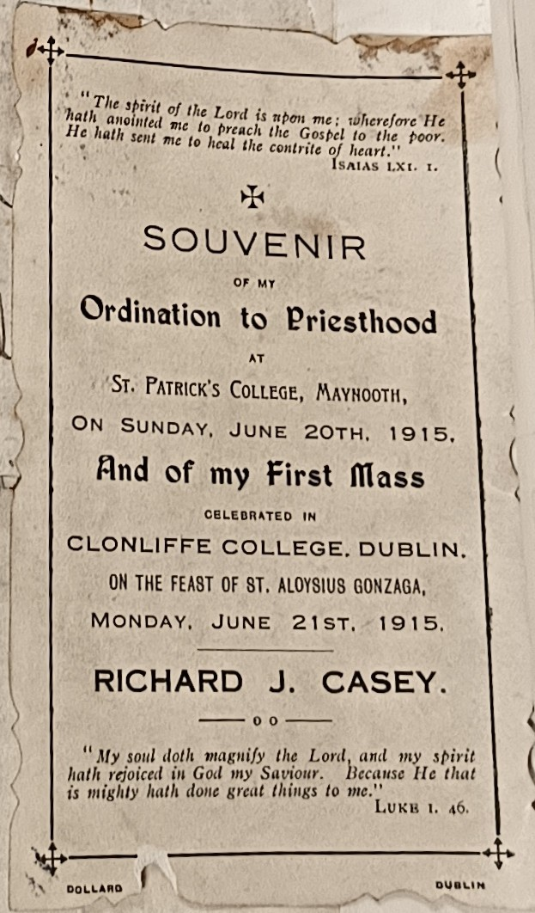

**Education**

-   CBS

<!-- -->

-   Christian Brothers SChoool,

-   Augustinian Seminary in Dungarvan

-   Mount Melleray Seminary in Cappoquin (along with Joseph) - - matric and First Arts in the Royal Uni of Ireland

-   Complete Uni in Holy Cross College, Clonliffe Rd ... Clonliffe College, Dublin

-   The National University of Ireland

    -   graduated from the univeristy in the first year the uni was empowered to confer degress

    -   later entered theological school

    -   Theological Course in Maynooth &

-   pre-1915 Maynooth

    -   buncha Sinn Fein people

    -   Michael Casey memories of Ordination in Maynooth

        -   another person recalls Sports Day in Maynooth

        -   A reminder of RJC's time

## Lourdes

In 1913, Casey also seems to have been part of very large group of Irish pilgrims to Lourdes: 3000 in total, including 300 priests and another 200 with a religious affiliation, according to the newspaper clippings above, one in French and one in English, and both of which Casey had upscaled into a lantern slide. This *pèlerinage* seems to have been one of the events of the year for the *Lourdais* and it would have been quite the journey for the pilgrims on the boat and train. It would no doubt have been quite the badge of honour in New York too. Even today my parents are very proud of their visit to the miraculous site – although they did cycle there (and back) from Paris during their 1990s cycling-getaway heyday.

There are plenty of photos taken in Lourdes do but I never got to see them. I had it in my head Casey went later but perhaps he went several times, as has since become common. I used to live beside two spinster sisters, just off Meath St, and they had then been volunteering on trips to Lourdes for 25 uninterrupted years, and their living room contained a shrine full of tat. I must drop in some time, armed with a bottle of their beloved vodka, and excavate a few stories from them.
